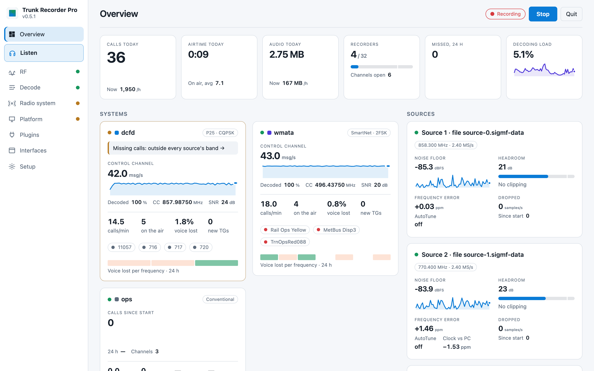

# Trunk Recorder Pro documentation

Trunk Recorder Pro records the calls on trunked and conventional radio systems, and is set up and
watched from a browser. What it supports (systems, radios, platforms) is listed in the
[README](../README.md).

<picture>
  <source media="(prefers-color-scheme: dark)" srcset="img/shots/overview-dark.png">
  
</picture>

Each topic has one home. Guides explain how and why, the reference lists every key, flag and
message, and the developer pages cover the internals. Other pages link to them.

## New here

1. [Choose how to run it](install/README.md):
   [macOS](install/macos.md), [Windows](install/windows.md), [Linux](install/linux.md),
   [Raspberry Pi](install/raspberry-pi.md), [Docker](install/docker.md), or
   [in the browser](install/browser.md) with nothing to install.
   [USRP, Airspy and SoapySDR radios](install/other-radios.md) need a driver.
2. [Getting started](getting-started.md): from a new install to your first recorded call, and how
   trunking works.
3. [Coming from Trunk Recorder](migrating-from-trunk-recorder.md): importing your config, and what
   is different.
4. [Troubleshooting](troubleshooting.md): when Start is refused, nothing is recorded, or audio is
   bad.

## Guides

### Setting it up

- [Radios](guides/radios.md): center frequency, sample rate, gain, frequency correction, more than
  one SDR
- [Adding a system from the directory](guides/from-the-directory.md): a system other users share
- [Find my system](guides/find-my-system.md): let the recorder scan for control channels
- [Talkgroups and unit names](guides/talkgroups-and-units.md): the talkgroup file and its format
- [Several systems and sites](guides/multi-site.md): multi-site calls and site lock

### Radio systems

- [P25](guides/p25.md)
- [SmartNet](guides/smartnet.md)
- [Trunked DMR](guides/dmr.md), with Hytera XPT
- [NXDN](guides/nxdn.md)
- EDACS: [its keys](configuration/systems.md#edacs) (no guide yet)
- [Conventional channels](guides/conventional.md)
- [Tones, NACs and colour codes](guides/tones.md): splitting a shared frequency

### Using it

- [The built-in interface](guides/interface.md): Setup, live listening, events
- [The dashboard](guides/dashboard.md): what each page and number means
- [Remote access](guides/remote-access.md): reaching it from elsewhere, signing in, passkeys,
  proxies, HTTPS
- [Recordings](guides/recordings.md): where calls go, the call JSON, what is kept, M4A
- [Signals](guides/signals.md): pages, alert tones, DTMF and Morse IDs heard in calls
- [Captures](guides/captures.md): recording what the radio receives, capture rules, the public
  corpus
- [Plugins](plugins/README.md): [OpenMHz](plugins/openmhz.md),
  [Broadcastify](plugins/broadcastify.md), [Rdio Scanner](plugins/rdioscanner.md),
  [streaming](plugins/simplestream.md), [running a script](plugins/upload-script.md),
  [MQTT](plugins/mqtt.md)
- [Interfaces](interfaces/README.md): pages for people who listen, each on a port of its own

## Reference

- [The config file](configuration/README.md):
  [sources](configuration/sources.md),
  [trunked systems](configuration/systems.md),
  [conventional systems](configuration/conventional.md),
  [recording](configuration/recording.md),
  [the store](configuration/storage.md),
  [server, log and monitor](configuration/server-and-log.md),
  [plugins](configuration/plugins.md)
- [Command line](command-line.md)

## Building on it

- Your own data: [the call JSON](guides/recordings.md#the-call-json), the calls HTTP API
  ([OpenAPI](api/calls.openapi.yaml)), [the store](configuration/storage.md) and the
  [SigMF extension](sigmf/trp.sigmf-ext.md) captures are written with
- [The interface API](api/README.md): the WebSocket protocol the built-in interface uses, for
  building your own ([for language models](api/llms.txt)), and
  [publishing an interface](interfaces/publishing.md) in the interface store
- [Writing a plugin](plugins/writing-plugins.md): its [events](developer/plugins/events.md),
  [protocol](developer/plugins/protocol.md) and [writing an uploader](developer/plugins/uploading.md),
  and [node health reports](api/node-health.md)

## Developers

- [Development](developer/README.md): building from source, making a release, the code layout,
  CPU cost
- [Architecture](developer/architecture.md): how it works, from SDR to audio file. An
  [illustrated version](developer/architecture.html) has diagrams, and may lag the text.
- [Testing](developer/testing.md): the test suites, regression captures and the IQ corpus
- [Developer tools](developer/tools.md): the `tool` subcommands for measuring and synthesizing
- [Performance](developer/performance.md): CPU use measured against Trunk Recorder
- [Interface style](developer/ui-style.md)
- Protocol notes: [Hytera XPT](developer/protocols/xpt.md), [DMR GPS and data](developer/protocols/dmr-gps.md)
