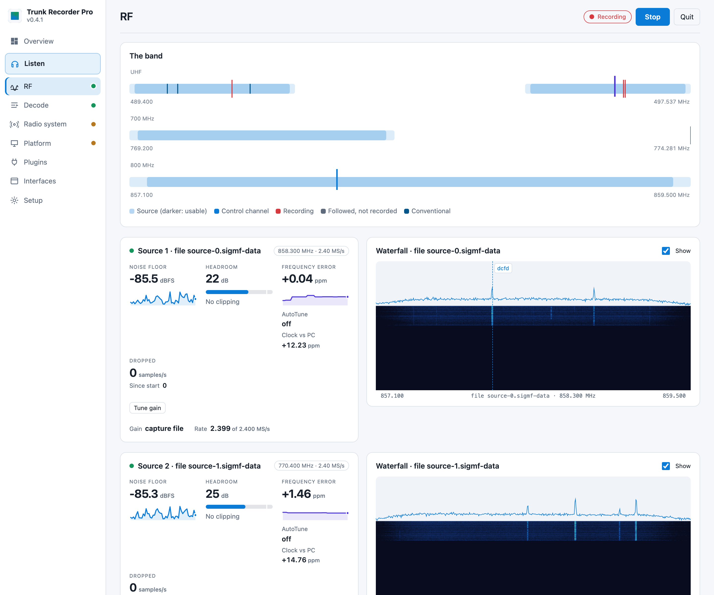

# Development

How to build Trunk Recorder Pro from source, make a release, and find your way around the code.

| Page | What it covers |
|---|---|
| [Architecture](architecture.md) | How the recorder works inside, from the radio to a saved call ([illustrated version](architecture.html)) |
| [Testing](testing.md) | The tests, the regression captures and the corpus; the house rules for a change |
| [Developer tools](tools.md) | The `trunk-pro tool …` commands for measuring and testing the decoders |
| [Performance](performance.md) | CPU use measured against Trunk Recorder, and earlier verification |
| [Interface style](ui-style.md) | How the interface looks and is organized |
| [DMR GPS and data](protocols/dmr-gps.md) | GPS and Hytera packet/signalling formats, sources and validation |
| [Hytera XPT](protocols/xpt.md) | Protocol notes and evidence for the XPT decoder |
| [Plugin events](plugins/events.md) | Every topic a plugin can subscribe to, field by field |
| [Plugin protocol](plugins/protocol.md) | The wire format and every message, for plugins in other languages; settings schema hints |
| [Writing an uploader](plugins/uploading.md) | A plugin that sends calls to a service: keys, `CallQueue`, `Attempt`, requests, node health reports |

For the interface API see [api/README.md](../api/README.md); for plugins, the guide is
[Writing a plugin](../plugins/writing-plugins.md).

## Building

Needs Rust 1.99+, Node 22+ (for the interface), the `wasm32-unknown-unknown`
target and `wasm-bindgen-cli` at the version in `Cargo.lock` (0.2.129). The
interface uses the recorder's own config rules — why Start would refuse, where
sources go, how a config is read — compiled to WebAssembly from
`crates/trunk-web` (`web/src/rules.ts`), so it needs that built first, in both
versions:

```bash
git clone https://github.com/TrunkRecorder/trunk-recorder-pro.git && cd trunk-recorder-pro
rustup target add wasm32-unknown-unknown
cargo install wasm-bindgen-cli --version 0.2.129 --locked
(cd web && npm ci && npm run wasm)      # the WebAssembly rules → web/src/web/pkg
(cd web && npm run build)               # the interface → web/dist, embedded in the binary
cargo build --release                   # target/release/trunk-pro
cargo build --profile dist              # stripped, as released
```

Build the interface before the binary, which embeds `web/dist` when it is compiled, so rebuild
the binary after changing the interface. Without `npm run wasm` the interface build stops at
`Could not resolve "./web/pkg/trunk_web.js"`. `npm run build` type-checks (`tsc`) and then runs
`vite build`.

Run `npm run wasm` again after changing a rule in `trunk-app`'s config (or
`trunk-web`): the interface and its tests use what it last built. After changing
`web/src/protocol.ts`, run `npm run schema` (in `web/`) to regenerate
`docs/api/protocol.schema.json`.

[Testing](testing.md) says how to run the tests.

Release packages: `packaging/package.sh <macos|linux-x86_64|linux-aarch64|windows-x86_64|browser> <version> <binary> <out-dir>`
(what CI runs; see the top of the script).

## Releasing

A release is a commit that bumps the version, and a tag on it. With
everything for the release already pushed to `main`:

1. **`Cargo.toml`**: `[workspace.package] version` (`0.2.0` → `0.2.1`). If any corpus capture has a
   `next.jsonl`, also run `trunk-pro tool corpus release <version>` ([corpus/README.md](../../corpus/README.md)).
   `trunk-core`, `trunk-app`, `trunk-pro` and `trunk-web` take it from
   there; the plugin SDK (`trunk-recorder-plugin`) has its own version
   (below).
2. **`Cargo.lock`**: refresh it with `cargo check`. Four entries change
   (the four crates above).
3. **`CHANGELOG.md`**: rename `## [Unreleased]` to `## [<version>] — <date>`,
   or add that section under it, and leave an empty `## [Unreleased]` on
   top. The release notes are this section, copied as it is, so write it
   for users: what's new, what changed, and anything they must change
   (config keys, say) first, in bold.
4. **Screenshots**: `(cd web && npm run build) && cargo build --release -p trunk-pro`, then
   `(cd web && npm run shots)`. It retakes the docs' pictures from the interface as it is now
   ([Screenshots](#screenshots)); the release build stops if they are older than the interface.
5. Commit as `v<version>` (with `docs/img/shots`), tag, push both:

   ```bash
   git commit -am "v0.2.1"
   git tag -a v0.2.1 -m v0.2.1
   git push origin main v0.2.1
   ```

Then `.github/workflows/build.yml` takes over. It stops if the tag doesn't
match `Cargo.toml`. It builds the packages (macOS DMG and CLI, Linux x86-64 /
ARM64, Windows, browser) and publishes the GitHub release with `SHA256SUMS`
and the changelog section. It then tells
[trunkrecorder.pro](https://trunkrecorder.pro) to rebuild its download links
and `/app/` (`SITE_DEPLOY_TOKEN`; without the token the site still finds the
release within the hour). A tag with a suffix (`v0.2.1-rc.1`) makes a
prerelease and leaves the site alone. Watch it with `gh run watch`.

The same tag starts `.github/workflows/docker.yml`, which builds the Docker
image for linux/amd64 and linux/arm64 and pushes it to Docker Hub as
`robotastic/trunk-recorder-pro` with the tags `<version>`, `<major.minor>` and
`latest` (a prerelease gets only its own tag). Every push to `main` also
publishes `edge`. It needs the `DOCKERHUB_USERNAME` and `DOCKERHUB_TOKEN`
repository secrets; without them the image is built but not pushed.

If CI fails, fix it on `main` and move the tag:
`git tag -fa v0.2.1 -m v0.2.1 && git push -f origin v0.2.1`. Do this only
before anyone has downloaded the release.

The plugin SDK is released apart from the app, only when its API changes:
bump `crates/trunk-recorder-plugin/Cargo.toml`'s `version`, refresh
`Cargo.lock`, commit, and `cargo publish -p trunk-recorder-plugin`. Plugins
pick it up from crates.io. `API_VERSION`
(`crates/trunk-recorder-plugin/src/protocol.rs`) changes only when a plugin
built for the old one would break.

`web/`: `npm run dev` serves the interface with hot reload on :5173, talking to
a running `trunk-pro` on :8080.
How the interface looks and is organized (type, tokens, Setup's sections,
cards and groups, wording) is in [Interface style](ui-style.md);
new screens should follow it.

The browser version runs the engine there too (the same WebAssembly):

```bash
(cd web && npm run wasm && npm run build:web)   # → web/dist-web
(cd web && npm run dev:web)                     # hot reload, engine in the page
```

## Screenshots

The pictures in the docs are taken by a script, from the real interface, so they show what is on
the screen now. `web/scripts/shots.config.mjs` lists them: each shot's name, the page it is of and
how it is reached. `npm run shots` (in `web/`) runs the release binary on a config of its own,
plays two corpus captures as its radios (a P25 and a SmartNet system), and takes each screen in
headless Chrome, in the light and the dark theme. They are written to `docs/img/shots/` as
`<name>-light.png` and `<name>-dark.png`.

```bash
(cd web && npm run build) && cargo build --release -p trunk-pro
target/release/trunk-pro tool corpus fetch --only phase2,smartnet   # once
(cd web && npm run shots)                      # all of them, about a minute and a half
(cd web && npm run shots -- --only rf,listen)  # some
```

It needs Google Chrome or Chromium (`CHROME=/path` to name one). A picture is rewritten only when
the interface's source changed or it shows something else, so a run with nothing new changes no
file. `docs/img/shots/shots.lock.json` records the version and a hash of the interface's source
the pictures were taken of. Folders of the run are shown as `/home/trunk/…`, and the state pill
says "Recording" where a capture playing would say "Replaying".

A doc shows a shot in both themes:

```html
<picture>
  <source media="(prefers-color-scheme: dark)" srcset="../img/shots/rf-dark.png">
  
</picture>
```

To add one, add it to `shots.config.mjs`, run `npm run shots -- --only <name>`, and show it in a
doc. Screens that need a radio plugged in (Find my system scanning, the gain tuner) aren't taken.

On a release tag CI runs `npm run shots:check -- --release` (the `shots` job of `build.yml`), and
the release waits for it: every shot still renders, every picture a doc shows exists, every shot
is shown by a doc, none is left over, and the interface hasn't changed since the pictures were
taken. Pushes and merges don't run it. The shots that play captures are skipped where the corpus
isn't fetched (the `CORPUS_READY` repository variable turns the fetch on).

## Code layout

```
radio (RTL-SDR, HackRF, USRP, Airspy, HydraSDR, bladeRF, SoapySDR, capture file) ─► IQ
  ─► Channelizer: one shared FFT per radio, a "head" per channel, 1 s of pre-roll history
      ├─ control channels ─► receivers ─► framer ─► TSBK (P25) / OSW (SmartNet) / EDACS messages / CSBK (DMR) / CAC (NXDN)
      │                                         ─► Message ─► call manager (grants, timeouts)
      ├─ voice channels, opened per grant with pre-roll
      │     ─► receivers ─► framer ─► voice tracker ─► IMBE / AMBE+2 vocoder ─► 8 kHz audio
      └─ conventional channels: energy in the shared spectrum ─► open with pre-roll ─► FM / AM / P25 / DMR / NXDN voice
  ─► call ends ─► best copy across sites ─► WAV + Trunk Recorder JSON ─► M4A, plugins
P25 receiver bank = CQPSK + CQPSK with a T/2 CMA equaliser + C4FM, best of each frame
```

[Architecture](architecture.md) explains the whole path, the
threads and how the pieces connect.

| Path | What |
|---|---|
| `crates/trunk-core` | Platform-independent core (native and WebAssembly): no I/O; depends on `rustfft`, `num-complex` and `regex-lite` only |
| `…/dsp/channelizer.rs` | Overlap-save multi-head channelizer (after CyberEther's `filter_engine`), pre-roll, waterfall spectrum |
| `…/dsp/cqpsk.rs`, `c4fm.rs`, `msd.rs` | Streaming receivers with soft bits; optional CMA equaliser; multi-symbol detector |
| `…/dsp/fm.rs` | Narrowband FM: channel filter / carrier meter, discriminator, de-emphasis, 8 kHz audio, CTCSS high-pass, squelch gate |
| `…/dsp/inband/` | In-band signalling, one path for every call: tones and the patterns they make up (pages, alert tones, DTMF / KNOX, Morse IDs), CTCSS / DCS (`subaudible.rs`), MDC1200 / FleetSync unit IDs (`units.rs`) |
| `…/dsp/am.rs`, `squelch.rs`, `rolloff.rs` | AM (airband), the carrier squelch, a radio's band-edge roll-off |
| `…/p25/frame.rs` | Framer with flywheel sync and NID recovery |
| `…/p25/tsbk.rs` | Viterbi (soft) trellis decoder + CRC — 98–99 % of TSBKs on simulcast, vs 62 % for op25's greedy decoder |
| `…/p25/fec.rs`, `voice.rs` | Golay / Hamming (hard and soft), Reed–Solomon, IMBE framing, LC / ES / HDU / TDULC |
| `…/p25/diversity.rs` | Receiver diversity: per-frame best of several receivers |
| `…/p25/phase2.rs` | Phase 2 TDMA: slot framer, scrambler, ISCH / DUID, AMBE codeword FEC, ESS, MAC PDUs |
| `…/smartnet/` | SmartNet: 3600 baud receiver, OSW framing and decoding, band plans |
| `…/edacs/` | EDACS: control channel framing (BCH), messages, sites, ProVoice |
| `…/dmr/` | DMR: burst framing, slots, FEC, link control, CSBKs, trunking (Capacity Plus / Max, Connect Plus, Tier III) |
| `…/nxdn/` | NXDN: frame sync and scrambler, LICH, the convolutional / CRC channel coding (SACCH, FACCH1, UDCH, CAC, SCCH), layer 3 messages, voice, Type-C and Type-D trunking, a synthesizer for tests |
| `…/mbe/` | IMBE and AMBE+2 vocoders (mbelib + Trunk Recorder's enhanced synthesis) |
| `…/trunk/` | Control-channel messages (Trunk Recorder's `p25_parser.cc`), call manager (`monitor_systems.cc`), Phase 1, TDMA and DMR voice tracking, conventional channels, multi-site dedupe, the engine (several radios and systems) |
| `…/survey.rs` | **Find my system**: band scan, control-channel check, band plan and ppm |
| `crates/trunk-app` | The app layer shared by desktop and browser: config (`config.rs`, with `migrate.rs` upgrading older ones), the conventional channel CSV (`channels.rs`), file names, and a recording `Session` (status, spectrum, log, calls, files) |
| `crates/trunk-pro` | The desktop app: `serve` (default; radio threads, a decoding thread per source, engine thread, web server + WebSocket), `replay`, `capture`, `devices`, `survey`, `rolloff`, `tune`, `tool`, `plugin`, `interface`, `access` |
| `…/src/sdr.rs` | The radio runtime every driver shares: the `Radio` trait, `run_with`, the `Sink`, retune / gain `Control`, the stuck-stream check |
| `…/src/radio/` | The drivers: RTL-SDR (`rtlsdr-nusb`) and HackRF (`nusb`), pure Rust with no libusb / librtlsdr; Airspy, HydraSDR, bladeRF, SDRplay, SoapySDR and USRP (UHD's C API), loaded at run time when installed |
| `…/src/plugins/` | The plugin host, store and command line |
| `…/src/interfaces/` | The other interfaces: their servers, store and command line |
| `crates/trunk-recorder-plugin` | The plugin protocol, and a Rust SDK for writing plugins (on crates.io) |
| `crates/trunk-web` | The browser build: `Session` and the RTL-SDR driver (WebUSB) exported to JavaScript with `wasm-bindgen` |
| `web/` | The browser interface (React + Vite), embedded in the binary; `src/web/` runs the engine in a worker for the browser version |
| `research/native-bench` | Benchmarks, the C++ prototype, synthetic simulcast ground truth, comparison scripts — see its `RESULTS.md` |

## CPU cost

`perf/gate.py` counts the instructions each stage takes on synthetic IQ, which the binary makes
with its own synthesizers ([`tool p25synth`, `dmrsynth`, `nxdnsynth`](tools.md#synthetic-captures)):

| Stage | What runs |
|---|---|
| `radio-rtl`, `radio-hackrf`, `radio-airspy` | A radio's read path ([`tool perf`](tools.md#tool-perf)): its driver's per-block code, the sink, the queue |
| `p25-conventional`, `dmr-conventional`, `nxdn-trunked` | A `replay` of a call: channelizer, receivers, framing, vocoder, WAV |

It counts instructions rather than time because they don't change with clock speed, turbo, heat or
whatever else the computer is doing. In CI, the `perf` job counts under Valgrind (exact, the same
every run) and fails when a stage is more than 2 % above `perf/baseline.json`. A change that adds CPU
on purpose updates the baseline: take the counts from the job's `perf-counts` artifact (or run
`perf/gate.py --update` on Linux x86-64 with Valgrind and Rust 1.99.0, the version the job pins), so
the increase shows in the diff. A new Rust version moves every count, so its baseline comes with
the upgrade.

Locally, compare two builds on this computer's hardware counter (`/usr/bin/time -l` on macOS,
`perf stat` on Linux):

```bash
cp target/release/trunk-pro /tmp/trunk-pro-before   # before the change
cargo build --release -p trunk-pro                   # after
perf/gate.py --against /tmp/trunk-pro-before
```

Hardware counts vary by about 0.2 % from run to run, so each is the median of three (`--runs`).
`perf/gate.py count --to FILE --name NAME -- CMD…` counts any one command, for scripts that replay
real captures.
