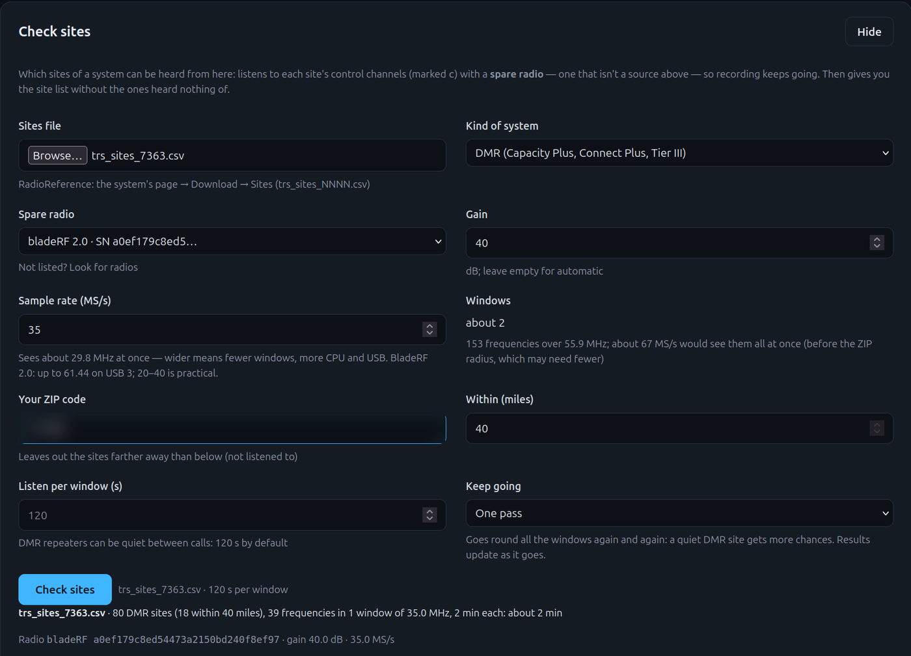
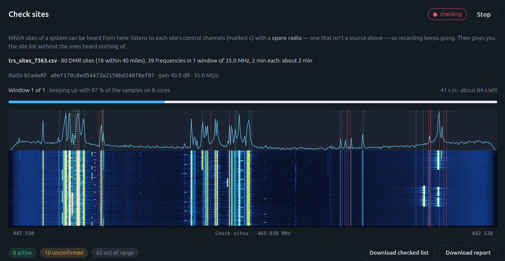
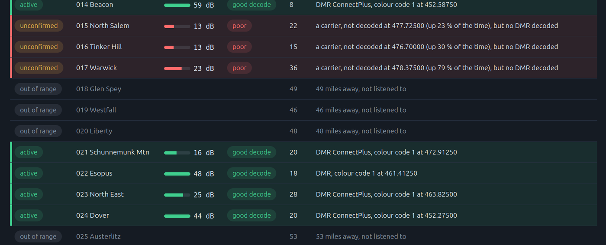

# Check which sites you can hear

`trunk-pro check-sites` takes a system's site list from RadioReference and tells you which of
its sites can be heard where you are. It writes the list again without the sites it heard
nothing of, ready to set the system up from, plus a report of what each frequency showed.

It runs **beside the recorder, on a spare radio**: an SDR the recorder isn't using (an RTL-SDR
is enough). Recording carries on with the other radios. Find my system, by contrast, takes over
one of the recorder's own radios, so recording has to stop.

There are two ways to run it: in the web interface (**Setup → Systems → Check sites**), or from
the command line. Both do the same check.

## In the web interface

On **Setup → Systems**, below Find my system, open **Check sites**:



1. **Sites file**: choose the `trs_sites_NNNN.csv` you downloaded.
2. **Kind of system**: P25, SmartNet, EDACS, DMR or NXDN.
3. **Spare radio**: the radios found are listed; the recorder's own sources are greyed out. Not
   listed? *Look for radios*, or pick *Another radio* and type its serial (or, for SoapySDR, its
   device arguments, e.g. `driver=sdrplay,serial=…,mode=ST`).
4. Optional: **Gain** (empty = automatic), **Sample rate**, **your ZIP code** and **within** so
   many miles (the farther sites aren't listened to), **listen per window**, and **keep going**
   for up to 24 hours.

   **Sample rate** sets how wide the radio looks. Once the sites file is chosen, the page shows
   how many windows that takes, and the rate that would see every frequency at once. With one
   window, every frequency is listened to all the time, which suits a long DMR run. A bladeRF 2.0
   at 30–40 MS/s covers most UHF systems; wider costs more CPU and USB bandwidth.

   **How much the computer can do.** Every frequency in a window has its own receivers, so a wide
   window with dozens of frequencies is real work. The check:
   - runs only the receivers for the kind of system you picked;
   - spreads a window over half the computer's CPU cores, leaving the rest for recording;
   - lowers a bladeRF's or USRP's rate to the least that still sees every frequency at once.
   While it runs, it says what share of the radio's samples the computer keeps up with. Under
   80 %, it warns you; samples it can't keep up with are missed. A lower rate, or a ZIP radius
   (fewer frequencies), helps.
5. **Check sites**.



A waterfall shows what the radio sees, with a marker on each frequency, green, yellow or red by
how well it has decoded so far. The table fills in as it goes (every second, not only at the end
of a window): each site's verdict and why, its signal strength (its strongest
peak, dB over the noise floor), and what each frequency showed. Rows are coloured by how well they
decoded:

| Colour | Decode | Means |
|---|---|---|
| Green | good | It decodes cleanly (P25 / SmartNet: 90 % of its frames or more) on a signal 12 dB or more over the floor |
| Yellow | marginal | It decodes, but with errors (50–90 %), on a weak signal, or only partly (P25 with no control messages) |
| Red | poor | Nothing decoded, or most of what it framed failed |

A site's colour is its best frequency's.

 A long
run updates it after every window. **Stop** keeps what was heard. **Download checked list** and
**Download report** give you the two files; they're also saved on the recorder's computer, in
`site-checks/` beside its config.

Only one check runs at a time. It keeps going if you close the page.

## What you need

- The system's **sites export** from RadioReference: on the system's page, *Download → Sites*
  (`trs_sites_NNNN.csv`). It lists every site with its frequencies; control channels are marked
  `c`.
- **A spare radio** the recorder isn't using. Two programs can't open one radio at once, so it
  must not be one of the recorder's sources.
- The **kind of system**: `p25`, `smartnet`, `edacs`, `dmr` or `nxdn`.

## From the command line

```bash
trunk-pro check-sites ~/Downloads/trs_sites_7687.csv --type p25 --rtl 00000002
```

Pick the radio with one of:

| Flag | Radio |
|---|---|
| `--rtl SERIAL` | An RTL-SDR (2.4 MS/s, AGC unless `--gain`) |
| `--airspy SERIAL` | An Airspy (6 MS/s, a Mini's rate: an R2 needs `--rate 10000000` or `2500000`; `--gain` is its linearity step, 0–21) |
| `--bladerf SERIAL` | A bladeRF (8 MS/s) |
| `--soapy "driver=…"` | Any SoapySDR radio (2 MS/s), e.g. `driver=sdrplay,serial=…,mode=ST` |
| `--usrp "serial=…"` | A USRP (8 MS/s) |
| `--radio '{…}'` | A source exactly as in `config.json` (with its `rateHz`) |

`--rate Hz`, `--gain dB` and `--ppm` change the defaults. A wider rate covers more frequencies
at once, so the check takes fewer windows.

It tunes the radio a window at a time, listens to every listed frequency in the window together,
and prints what each one showed as it goes. At the end it prints each site's verdict and writes
two files next to the export:

- `trs_sites_7687-checked.csv`: the export without the sites marked **inactive** or **other
  site**. Lines are copied exactly, so it reads like the original.
- `trs_sites_7687-report.csv`: one row per frequency, with what was heard on it, how much of the
  time its carrier was up, its strength, and the site's verdict and why.

The verdict lines show each site's signal and decode (on a terminal, in green, yellow or red,
as in the web page; `NO_COLOR=1` turns the colours off), and the report has a *Decode* and a
*Decoded %* column. `--out` and `--report` name the files yourself. Your original export is never changed. The
first lines it prints name the radio and the gain it opened with.

### Only the sites near you

```bash
trunk-pro check-sites trs_sites_7363.csv --type dmr --rtl 00000002 --zip 12601 --within 40
```

`--zip` (a US ZIP code) or `--near lat,lon` says where you are; `--within` is in miles. The sites
farther away aren't listened to: they're listed first with their distance and marked **out of
range**. A site whose row has no location is kept in. The ZIP codes are the Census Bureau's ZIP
Code Tabulation Areas, built in (no internet needed).

### A long run

```bash
trunk-pro check-sites trs_sites_7363.csv --type dmr --rtl 00000002 --zip 12601 --within 40 --for 12h
```

`--for 12h` (or `90m`, `3600s`) goes round all the windows again and again for that long, adding
up what each frequency showed. A DMR site that keys up once in the night counts. The two files are
written after every window, so **Ctrl+C** at any time keeps what was heard up to then.

## How each kind of system is judged

| `--type` | Listens to | A site is **active** when |
|---|---|---|
| `p25` | its control channels (`c`) | a P25 control channel decodes, and its NAC, RFSS and site match the row (where the row gives them) |
| `smartnet` | its control channels | a SmartNet control channel decodes, on a frequency only this site uses |
| `nxdn` | its control channels | an NXDN Type-C control channel decodes, on a frequency only this site uses |
| `edacs` | its control channels | a control channel's carrier is up at least 80 % of the time, on a frequency only this site uses (EDACS isn't decoded by this check) |
| `dmr` | its control channels | DMR decodes on a frequency only this site uses, as the system's kind of DMR |

A site with no `c` marks has all its frequencies checked.

**Shared frequencies.** When several sites list the same control channel, hearing it doesn't say
which of them it was, so it confirms none of them by itself (they're **unconfirmed**). P25 is the
exception: its control channel says its own site number.

**The system's kind of DMR.** A DMR system's sites are one kind of trunking (Capacity Plus,
Connect Plus, Capacity Max, Tier III): the kind most of its sites decode as. A site whose frequency
decodes as another kind is a neighbouring system on it, so it's **unconfirmed**.

**Listening time.** A control channel transmits all the time, so 4 seconds per window is plenty.
A DMR Capacity Plus site has no control channel, and its repeaters can be quiet between calls, so
`dmr` listens for 120 seconds per window. A busier or quieter system may want a different
`--seconds`. A DMR site judged inactive was only quiet *while it was listened to*; check again at
a busier time before dropping it for good.

## The verdicts

| Verdict | Means | Kept in the checked file |
|---|---|---|
| **active** | Heard as itself | yes |
| **other site** | P25: a control channel decoded, but it announced another site's NAC or site number (a neighbour reusing the frequency) | no |
| **unconfirmed** | Something is on its frequency, but not confirmed as this site: nothing decoded (too weak, or another system), another kind of DMR, or only a frequency other sites share | yes |
| **inactive** | Nothing was heard | no |
| **not checked** | None of its frequencies were listened to (with `--capture`: outside the capture's band) | yes |
| **out of range** | Farther away than `--within` | no |

## Trying it on a capture

`--capture file --center Hz --rate Hz` checks the frequencies inside a recorded capture instead
of a radio (one window, as fast as the file plays), with the same output:

```bash
trunk-pro check-sites trs_sites_NNNN.csv --type nxdn --capture capture.cu8 --center 451000000 --rate 2400000
```
