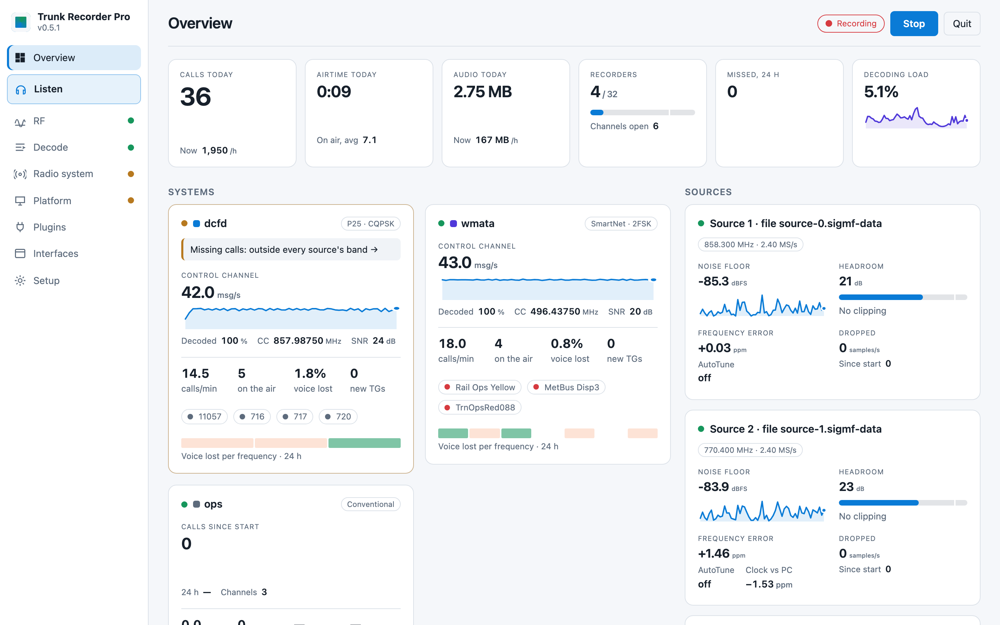
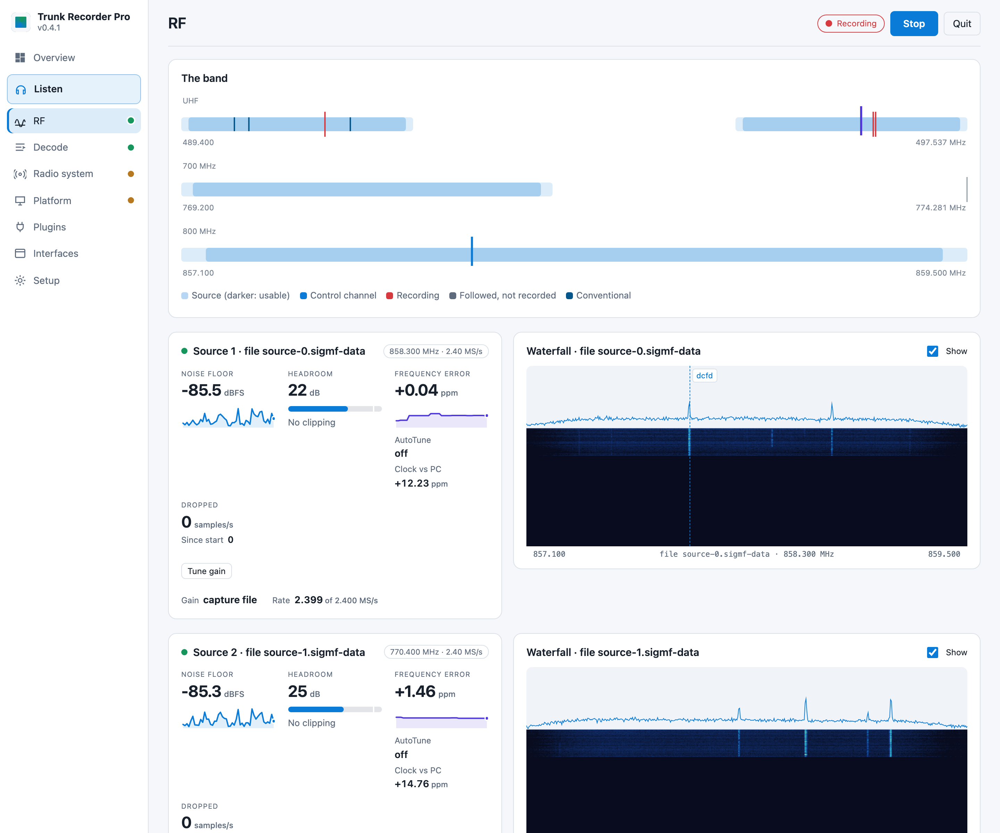
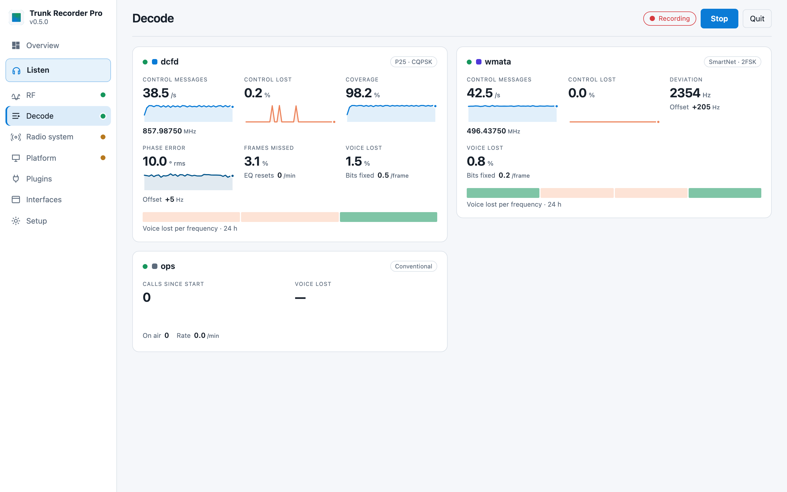
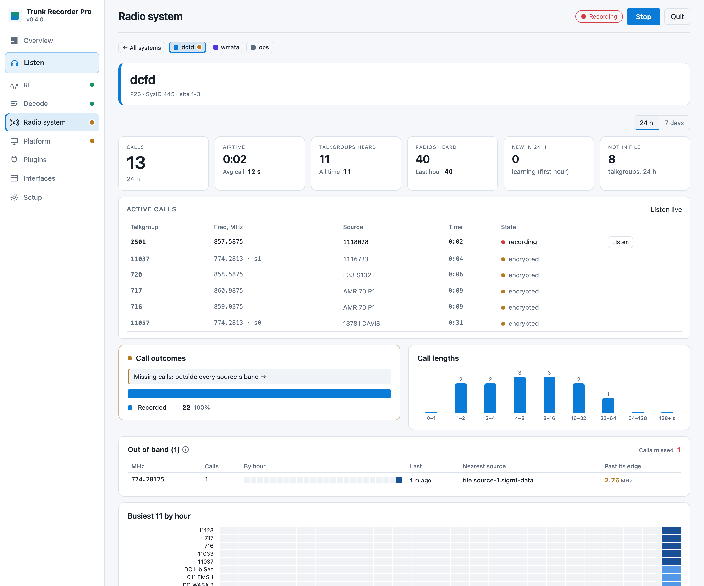
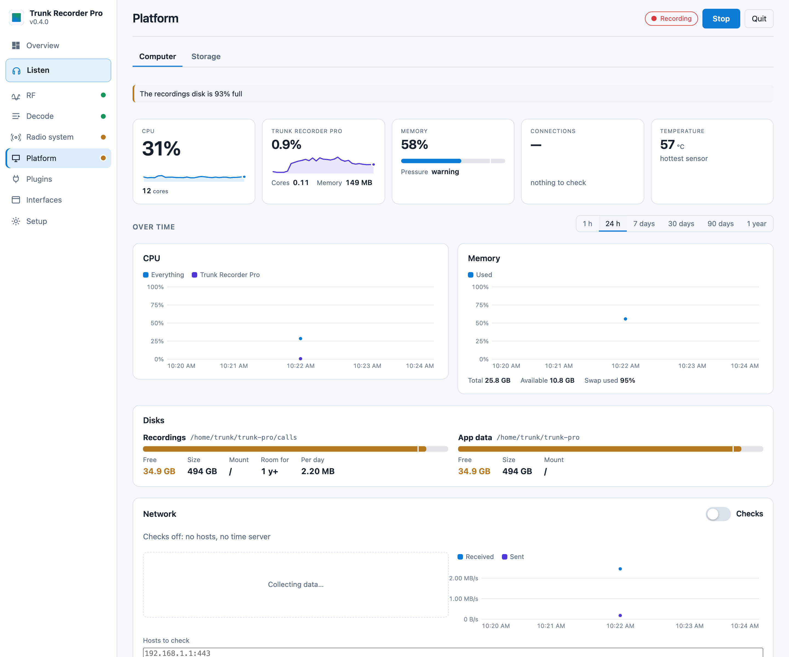
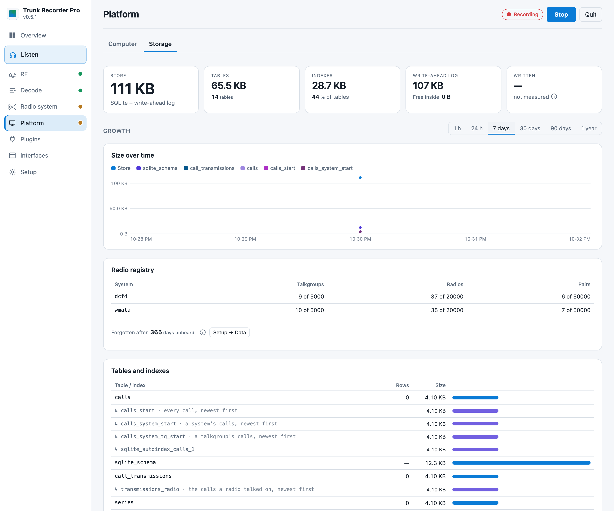

# The dashboard

The dashboard pages show how the recorder is doing: whether each system's control channel is
decoding as usual, how well the radios hear the air, how clean the voice is, what the system is
doing, and whether the computer and plugins are keeping up. This page goes through each one and
what its numbers mean. For the frame around them, Setup and the Listen page, see
[The built-in interface](interface.md).

Most numbers come with a small chart of the last 10 minutes, and many pages have an **Over time**
section with a **Span** of **1 h**, **24 h**, **7 days**, **30 days**, **90 days** or **1 year**.
The longer spans are offered as far as the store keeps history: a year by default
(`storage.statsDays`; 0 keeps all), and 7 days when there is no store. The history survives
restarts (see [The store](../configuration/storage.md)). While
stopped, the pages show past data where they can.

Several numbers are compared with **the usual**: that series' average over the last 24 hours.
The shaded band on a chart is its usual range, and an arrow shows how far today is above or below
it. This is how the dashboard tells "the system is quiet tonight" from "reception got worse".

### Reset counts

Some numbers are totals since Start: a radio's dropped samples and errors, the calls concluded, a plugin's sent,
skipped and failed (and why), its restarts and events it fell behind on, and the RAM spool's overflows and
deletions. **Reset counts**, in the top bar while recording, counts them from now: they read **Since 14:05** in
place of **Since start**, so a single dropped sample after a fix stands out. Only this browser counts from the
reset; the recorder, its history and everyone else's view don't change. Press it again to count from a later
time, or **✕** to go back to since start. A new run (Stop, then Start) starts its totals at nothing, so they
are then all since the reset. Trunk Monitor has a reset of its own.

## Overview

<picture>
  <source media="(prefers-color-scheme: dark)" srcset="../img/shots/overview-dark.png">
  
</picture>

While recording, the top row is today's big numbers ("today" is since local midnight, across
restarts):

| Number | What it is |
|---|---|
| **Calls today** | Calls saved today, with how many an hour right now and the last hour against the usual |
| **Airtime today** | Total length of today's calls, and how many are on the air at once on average |
| **Audio today** | Size of today's audio, and how much an hour right now |
| **Recorders** | Calls being recorded now, of **Recorders** in Setup, and how many channels are open. Amber when they're all busy. |
| **Missed, 24 h** | Calls not recorded because no recorder was free or no source covered the frequency. Click to see the Radio system page. |
| **Decoding load** | How much of one CPU core decoding takes. Over 100% means it's using more than one core, which is fine on a multi-core computer. |

While stopped, the top row says **Not recording** (with **Start** and **Setup** buttons), and each
system card shows **Last 24 h** instead of live numbers.

Below that is a card for each system. Click its name to go to its Decode page.

- **Control channel** (trunked systems): control messages decoded a second, against the usual;
  the share decoded; the control channel's frequency (or `hunting` while it looks for one); and
  its SNR.
- **calls/min**, **on the air** now, **voice lost** (the share of voice frames that couldn't be
  decoded over the last 10 minutes; under 2% is clean), and **new TGs** (first heard in the last
  24 hours).
- Chips for the talkgroups on the air; click one for its page.
- A conventional system's card shows **Calls since start**, with the last 24 hours, the number of
  channels and how many are **Open** (a signal on them now).
- **Voice lost per frequency · 24 h**: one cell per voice channel, darker where more voice was
  lost. A dark cell or two at one end often means a source's band edge.

On the right are the **Sources** (as on the RF page, smaller), then **Status**: a **Computer**
line (CPU, memory, disk, RAM spool, internet), a **Plugins** line (sent, failed, queued for each
plugin that's on), and **Lately**, the event feed (see [Events](interface.md#events)).

## RF

<picture>
  <source media="(prefers-color-scheme: dark)" srcset="../img/shots/rf-dark.png">
  
</picture>

How well each radio hears the air. While stopped, it lists your sources' settings.

**The band** draws every source's passband on one axis, with the control channels, conventional
channels and calls (recording and followed-only) marked on it. The darker part of each passband
is what the source actually uses, its sample rate less the guard band at each edge. Use it to see whether your
sources cover what they should.

Each source then has a card:

| Number | What it means |
|---|---|
| **Noise floor**, dBFS | The median power across the band. It rises with gain, and with interference. A sudden rise with no gain change means something nearby started making noise. |
| **Headroom**, dB | How far the strongest signals are below full scale (the point where the radio clips). Under the meter: the share of samples clipping, if any. |
| **Frequency error**, ppm | How far off the radio's frequency is, measured against the control channels (the towers' frequencies are very accurate). With AutoTune on it's corrected as it's measured; otherwise it says **AutoTune** off. It needs a control channel to measure. Steady: set the source's ppm. Drifting: temperature. See [Radios](radios.md). |
| **Dropped**, samples/s | Samples the driver lost because the computer or the USB bus didn't keep up. Anything but zero is red: calls on that source lose audio. |

Under **Frequency error** is **Clock vs PC**, the radio's sample clock against this computer's,
in ppm. A source that none of the systems or channels use shows an **Unused** chip with
**Probably removable**.

While recording, editors also get a **Tune gain** button on a source (it stands out when the
gain looks too low or too high). It tries gains on the air, scores each by how well the systems
decode, and keeps the best. While it runs, the card shows **Tuning**, how long it has taken, how
many gains it **Tried** and the one it is **Trying**; **Stop** puts the radio back as it was.
Afterwards it shows what it **Kept** (or the **Best** one, if it wasn't applied), how many it
**Tried** and how long it **Took**. The same thing runs from the command line: see
[`trunk-pro tune`](../command-line.md#tune).

Under the card: the gain as set, the sample rate actually delivered against the one asked for,
and the source's errors, if any (a USB error, a dongle that went away).

The **Waterfall** beside each source shows its whole band over time, with the control channels
and active calls marked. **Show** turns it off; the browser remembers that, and the recorder
stops sending that spectrum. The sites' names run along the top, stacked on a second row where
two would overlap; an adjacent site has a fainter line, and its address shows when the pointer
is on it, as the readout under the pointer names any line. Calls are tagged on a row of their
own below, and the tag fades after a few seconds.

The dashboard names a source by its kind and the name Setup gives it ("Airspy · roof"), or by
its kind alone when it has none, with its number when two would read the same; the radio's full
label (for SoapySDR, its device arguments) is on hover.

Click a source's name for its own page, which adds:

- **Across the band**: the noise floor across the band (bars) and each channel's power above it
  (stems). 10 dB or more above the floor is clean. A floor that sags at the edges is the radio's
  roll-off; keep channels out of it (see the guard band in [Radios](radios.md)).
- **Channels on this source**: each channel's power, floor, **SNR** (green at 15 dB or more, amber
  from 8, red below), **Offset** (how far its carrier is from where it should be, in Hz) and
  **Quality** (see [Decode](#decode)). If every carrier is off by about the same ppm, it says so:
  set the source's ppm or turn on AutoTune.
- **Over time**: noise floor and peaks, frequency error (measured and corrected), dropped samples,
  clipping.

On the desktop app, editors also see an **IQ capture** card at the bottom of the page; see
[Recordings](recordings.md).

## Decode

<picture>
  <source media="(prefers-color-scheme: dark)" srcset="../img/shots/decode-dark.png">
  
</picture>

How well signals turn into messages and voice. A card per system:

| Number | What it means |
|---|---|
| **Control messages** /s | Control channel messages decoded a second, against the usual. How many there should be depends on the system: compare with its own usual. |
| **Control lost** % | Messages that didn't decode. A few percent is normal; amber over 10%, red over 30%. |
| **Coverage** % | P25: an estimate from timing of how much of the control channel decoded, against the most it could carry. Unlike messages a second it reads the same on every system: a multi-block message takes two or three TSBKs' air. Frames never caught count against it. 96–98% is healthy. |
| **Eye opening** | C4FM (P25 Phase 1 and most control channels): how well separated the four symbol levels are. 10 or more is clean, under 4 means errors, about 1 is noise. Simulcast systems read low even when they decode well. |
| **Phase error**, ° rms | CQPSK (simulcast P25, and Phase 2): how far symbols land from where they should. Under 10° is clean, amber from 15°, red from 20°, about 25° is noise. |
| **Deviation**, Hz | SmartNet: how far the signal swings. About ±2.4 kHz is normal; less means weak or filtered. |
| **carrier** (under these) | The control channel's carrier offset in Hz. A steady offset is the radio's frequency error. |
| **Frames missed**, % | P25: frames whose header (NID) failed or whose sync was missed, and how often the equaliser reset a minute |
| **Voice lost**, % of frames | Voice frames too damaged to use, over 10 minutes. Under 2% is clean, amber from 2%, red from 8%. Under it: bit errors the error correction fixed per frame. |

Each card also has a **Voice lost per frequency · 24 h** strip.

Click a system's name for its own page, which adds:

- its identity (NAC, WACN, SysID, site) and calls saved this run;
- **Channels now**: each open channel's SNR, offset and quality;
- **Over time**: decoded and lost control messages, control channel coverage (P25), voice frames
  lost, SNR with eye opening or phase error, carrier offset;
- **Frequencies, 24 h** (or 7 days): every voice frequency with calls, its source, **In band**
  (0% at the edge of the source's usable band, guard band left out, 100% at its centre), calls, SNR, offset, the share of voice
  frames decoded cleanly and lost, and an hour-by-hour strip. Above the table the page points out
  patterns: every frequency off by the same ppm, a frequency at a band edge decoding worse ("move
  the centre toward it"), or one frequency much worse than the rest (interference or a weak
  path);
- neighbouring sites, patches, and for DMR and NXDN the site's channels.

## Radio system

<picture>
  <source media="(prefers-color-scheme: dark)" srcset="../img/shots/radio-system-dark.png">
  
</picture>

The system as heard. With several systems it first shows a card each (talkgroups and radios in
24 hours, new talkgroups, talkgroups not in its file, the busiest talkgroups, what's on the air);
clicking a system's card goes to it. A system's own page has a **Span** of 24 hours or 7 days.

| Number | What it is |
|---|---|
| **Calls**, **Airtime** | In the span, with the average call length |
| **Talkgroups heard** | In the span, with how many in all time (**All time**) |
| **Radios heard** | In the span, with how many in the last hour (**Last hour**) |
| **New in 24 h** | Talkgroups first heard in the last 24 hours (`learning (first hour)` while it builds a baseline) |
| **Not in file** | Talkgroups heard in 24 hours but not in the talkgroup file |

**Call outcomes** splits the calls by what became of them: **Recorded**, **Followed
only**, **Ignored**, **Encrypted**, **Not in file**, **No recorder**, **Out of band** and **No
channel table** (granted on a channel that was never turned into a frequency). **No recorder**
and **Out of band** are calls you missed; see the reasons table under
[Active calls](#active-calls).

**Out of band** lists the frequencies those calls were granted on, in the span: how many calls,
by hour, when the last was, and the nearest source with how far past the edge of its usable
range each is (guard band left out). Move that source's centre toward them, widen its sample
rate, or add a source. It shows when there are some; **Out of band** in **Call outcomes**, and a warning of calls out of band (on the Overview too), open it.

Below the numbers: **Active calls** (see below), **Call outcomes** and **Call lengths**,
**Busiest … by hour**, **Who talks on what** (talkgroups and the busiest radios, linked by how
often each radio talks on each), the **Talkgroups** table, the **Radios** table, the
**Control channel log**, and last the **Tones** card (see [Signals](signals.md#the-tones-card)).

The **Talkgroups** table can show **All**, **New**, **Unknown**, **Ignored** or **Encrypted** (more
than half their calls encrypted), sorted by **Airtime**, **Calls**, **Latest** or **Newest**. The
**Ignore** button (trunked systems only, for people who may edit) stops recording a talkgroup by
marking it Ignore in the system's talkgroups; it takes effect at once, even while recording. Click
it again (**Ignored ✕**) to record it again.

Click a talkgroup or a radio anywhere for its own page. A talkgroup's page has **NOT IN FILE** and
**IGNORED** badges, **Calls, 7 days**, **Airtime, 7 days**, **Encrypted** and **Affiliated now**,
then **Last 7 days**, **Who talks here**, **Encryption heard** (cipher and key ID, when
encrypted calls were heard), its **Calls** (with **Play** and **Load older**) and **Affiliated
with it**. A radio's page has a **DEREGISTERED** badge when it deregistered, with who it talks
with, its latest transmissions, calls and affiliations. Names are edited there; see
[Editing a talkgroup](talkgroups-and-units.md#editing-a-talkgroup).

### Active calls

Near the top of a system's page: every call of that system on the air now, recording ones first. It
replaces the small "On the air now" card, and the old Live page (`#/live` and `#/calls` links open
the Radio system page).

| Column | What it shows |
|---|---|
| **Talkgroup** | Its number and name (click it for the talkgroup's page), `EMERG` for an emergency call, what it's patched with, `· <site>` for a call heard on another site of the system, `also on …` when the same call is on other sites (the best copy is saved), and `air <n>` on a conventional channel when the air named talkgroup `<n>` but the channel's row files it under another number |
| **Freq, MHz** | The voice channel, with `s0`/`s1` for a TDMA slot, `FM` or `AM` (and the FM tone) for analog, `NXDN48`/`NXDN96` and the RAN for NXDN |
| **Source** | The radio talking now: its name or talker alias when known, else its unit ID. Click it for the radio's page. |
| **Time** | How long the call has gone on |
| **State** | `recording`, `recording · encrypted`, or why it isn't being recorded |
| (button) | **Listen** plays just that talkgroup |

The reasons a call isn't recorded:

| State | Why | What to do |
|---|---|---|
| `encrypted` | The call is encrypted and encrypted calls are off | Nothing: encrypted audio can't be decoded |
| `out of range` | No source covers its voice frequency | Move a source's centre, or add a source. See [Radios](radios.md). |
| `no free recorder` | Every recorder is busy | Raise **Recorders** in Setup → Recording |
| `not in file` | It's not in the talkgroup file and **Unlisted talkgroups** is off | Add it, or turn that on in Call rules |
| `ignored` | It's set to Ignore in the talkgroup file | Un-ignore it on the Radio system page |
| `monitoring` | Followed, not recorded, for another reason | |

### Listening live

Tick **Listen live** to hear that system's calls as they're decoded, like a scanner. It stays on
one call until that call has been quiet for 2 seconds, then takes the next one. The line under the
heading shows what's playing (`▶ TG 3747 · <radio>`).

- Live audio is one system at a time: on another system's page it says "Listening: <system>".
- Turning on Listen's **Live feed** turns **Listen live** off, and the other way round (one sound
  at a time).
- The **Listen** button on a recording call plays only that talkgroup. A button then appears
  next to **Listen live** (`TG 3747 only ✕`); click it to go back to everything.
- Only calls being recorded can be heard.
- The audio comes from the recorder over the same connection as the rest of the page, so it works
  from another machine too.
- Safari can pause the audio when you switch tabs or audio devices; a click or key press anywhere
  on the page starts it again.

### Control channel log

At the bottom of a system's page, collapsed. Click **Control channel log** to open it. It shows that
system's last 150 control channel messages as they arrive, newest first (a site's name in brackets
for a system with several sites): grants, updates, patches, the system's identity, neighbouring
sites, talker aliases, protocol notes (such as a DMR site's colour code and kind), plugin notes and
errors. Tick **Unit activity** to also see affiliations, registrations and the like.

The log is only made while it's open, because turning every control message into a line costs
the recorder some work. This is not the same as the app's log file: see
[Log levels and log files](../troubleshooting.md#where-is-the-log).

## Plugins

The **Health** tab has a card for each plugin that's on (**Install & settings** is covered in
[Plugins](../plugins/README.md)):

| Number | What it is |
|---|---|
| **Sent** | Calls it handled this run, and how many it skipped |
| **Failed** | Calls it failed on, as a share of tries. Hover for the last failure. |
| **Waiting** | Calls queued for it (amber over 20), and how many are waiting to retry |
| **Age at delivery** | How long after a call ended the plugin finished with it, over the last 5 minutes (or the hour, when nothing was delivered in the last 5), and its parts: **held** by your delay rules, **waiting** (the call's files being finished, the plugin's queue, failed tries) and the plugin's own **upload**. Then the hour's longest. A plugin built before SDK 0.6 doesn't say its upload time, so only the age shows. All by this computer's clock: no service reports it. |

Under them: how much it has sent this run, a bar per minute for the last hour (sent, skipped, failed), **Why failed** and **Why skipped** (each reason the plugin gave this run, with how many calls), each service the plugin
talks to with its state, any figures of its own the plugin reports (simplestream's packets sent and
dropped, for example), and when it last succeeded and failed. **Restarts** means the plugin
crashed and was restarted; **Fell behind** (N events) means it was too slow to take events and some
were dropped. **Last 24 h and log ▾** shows its history (the age at delivery among it) and recent log lines.

The age at delivery is local, so it's only as right as this computer's clock: see [Clock](#clock).
A call recorded while the clock was off says so in its JSON (`"clock_off": true`).

A service shows as down after 3 failures in a row, or 5 minutes without a success.

## Platform

<picture>
  <source media="(prefers-color-scheme: dark)" srcset="../img/shots/platform-dark.png">
  
</picture>

The computer the recorder runs on, recording or not:

| Number | What it is |
|---|---|
| **CPU** | All cores together (of the container's limit, in a container). Amber over 90%. |
| **Trunk Recorder Pro** | The app's own CPU use, in cores, and its memory |
| **Memory** | Memory in use, and how much of the time programs stall waiting for memory (Linux) or the system's memory pressure (macOS) |
| **Connections** | Whether what the recorder reaches answers: the hosts it checks and the services the plugins send to, and how long a connection to a checked host takes |
| **Temperature** | The hottest sensor, and whether a Raspberry Pi is throttling (under-voltage or heat) |

**Over time** has CPU (with each core) and memory. **Disks** shows the **Recordings** disk, the
**App data** disk and the **RAM spool** if it's on, with free space, calls that overflowed from
the spool, and **Room for** at last week's daily average (and **Per day**). **Network** lists each
connection: the hosts checked (`monitor.checkHosts`, none by default), with their history minute by
minute, and each service a plugin reports, with how it answers. Its settings are under the list:
the **Checks** switch (off: no hosts and no time server are asked), the hosts to check, how often,
the time server, and **Check for updates** (asks GitHub once a day; a newer release shows beside
the version in the sidebar). **This computer** shows the system, cores, uptime and anything the
platform can't measure.

When the app has a store, the page has two tabs, **Computer** (the above) and **Storage**.

### Storage

<picture>
  <source media="(prefers-color-scheme: dark)" srcset="../img/shots/platform-storage-dark.png">
  
</picture>

What the store takes, and what it writes to disk (see
[The store](../configuration/storage.md)):

| Number | What it is |
|---|---|
| **Store** | The store's size on disk (SQLite and its write-ahead log, or PostgreSQL) |
| **Tables** | Their size and how many there are |
| **Indexes** | Their size, as a share of the tables |
| **Write-ahead log** | Its size, and the free space inside the store (SQLite) |
| **Written** | What the store writes to disk (commits, checkpoints and its daily backup), per day. It is what wears an SD card or eMMC. |

**Growth** has a **Span** and two charts, **Size over time** and **Written to disk**. **Tables and
indexes** lists each with its size, and what each index is for. **Radio registry** shows how full
the registry is against its limits. The settings are in Setup → Data.

### Clock

Call times come from this computer's clock. Calls from several recorders are matched by their
times, and services such as Broadcastify Calls go by them, so the clock is worth watching. The
recorder only watches it: the operating system's time service (chrony, systemd-timesyncd, ntpd,
macOS) keeps it. Nothing extra needs installing, and nothing runs with privileges.

| Number | What it is |
|---|---|
| **Offset, measured** | This clock less the time server's (`monitor.timeServer`, by default `pool.ntp.org`), from one SNTP query every 15 minutes, and whether this clock is behind or ahead. It's measured here, so it's right whatever the time service says. |
| **Operating system** | Whether the time service tells the kernel the clock is synchronized, and its own bound on the error. The bound is loose: a synchronized clock often claims hundreds of milliseconds. Linux and macOS; on Windows only the offset is measured. In a container this is the host's clock, which the container shares. |
| **Round trip** | The query's round trip. The offset is good to about half of it. |

Under them, when they're known:
- **Kept by**: the time service and the server it follows, its stratum and when it last
  synchronized (Linux: chrony or systemd-timesyncd).
- **Recording's own clock**: while recording. The recording runs on the clock as it was at
  Start, carried on by a clock that never jumps (on macOS one that runs at the crystal's rate, so it
  parts from the corrected clock by up to a few seconds a day). Call times are corrected to the clock
  as it is now all the same, with no Stop and Start: this line only says how far apart the two are.
  A call keeps the correction it began with until it ends, so its length and its talkers' times
  are as on the air even when the clock is stepped during it.
- **Radio systems' clocks**: P25 systems (Phase 2) broadcast their own time, to 7.5 ms,
  usually from GPS. Each site's line says how far its system's clock is ahead of or behind the
  calls' time ("3.0 s behind them": the system's clock is three seconds slow). Times are in ms under
  a second, then seconds. Some systems mark their time not valid, and those can be seconds off
  (or right, as DCFD's is): they're shown, not gone by. A system set to its local time is off by
  hours and isn't compared.

The chart shows this computer's clock against the time server over time, in ms. The Platform light turns amber, with an event, when call
times are off by `monitor.clockWarnMs` (250 ms) or more, or the operating system says the clock
isn't synchronized; red at 5 s. What's judged is the clock calls are stamped by:
- measured against the time server, as the clock now plus how far it has moved since Start;
- without an answer from the time server, against the radio systems that vouch for their time
  (offline recorders).

A measurement over an hour old isn't counted. A jump of the clock (its time service setting it, or
the computer sleeping) is an event of its own. Some networks block NTP (UDP port 123): then nothing
is measured, the card says the queries go unanswered, and the hosts checked don't count it.
Pointing `monitor.timeServer` at a server inside your network (often your router) can help.

The offset is local: nothing Broadcastify or another service reports. Broadcastify Calls doesn't
report how far off a recorder's clock is.

On macOS, if Spotlight is indexing the recordings folder, a note at the top explains how to
exclude it. See [Troubleshooting](../troubleshooting.md#spotlight).
