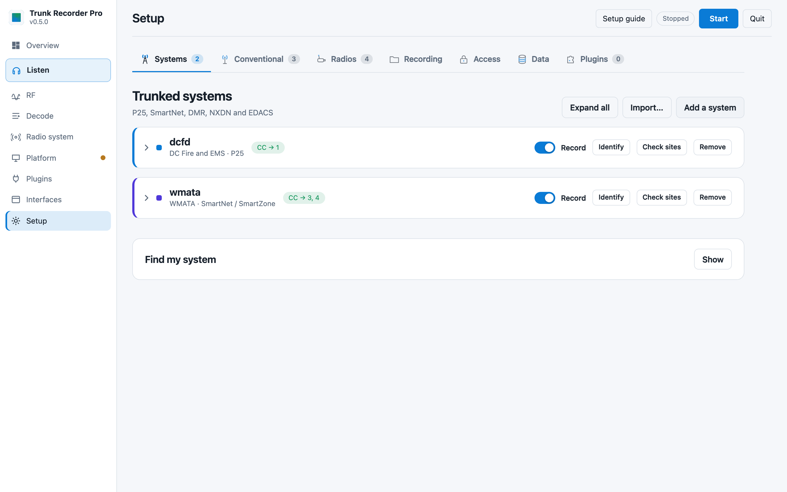
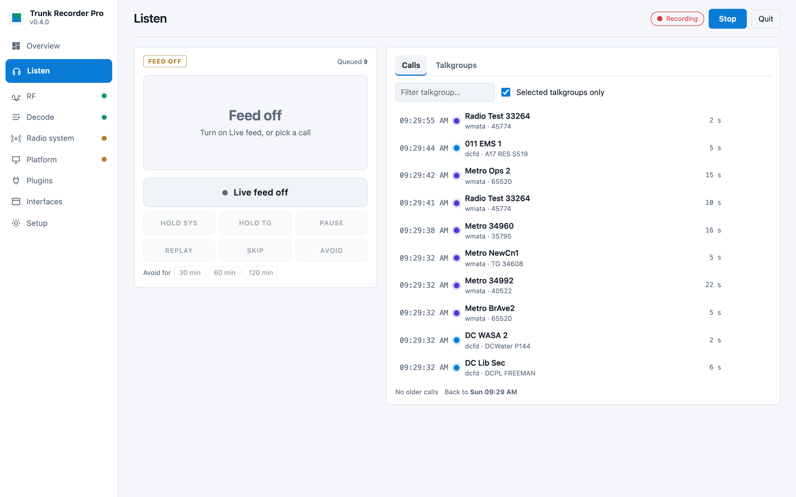

# The built-in interface

Trunk Recorder Pro is run from your web browser. This page is a tour of the interface: the
frame around every page, Setup, the Listen page, events, quitting, reaching it from another
machine, and the other interfaces it serves. The
measurement pages (Overview, RF, Decode, Radio system, Platform, Plugins) and what their numbers
mean are on [The dashboard](dashboard.md).

The interface needs a browser with WebAssembly SIMD (Safari 16.4, Chrome 91, Firefox 89 or later); an
older one shows "This browser can't run the dashboard". When you start `trunk-pro` it opens the
interface at <http://localhost:8080>. If you closed the
tab, open that address again, or start the app again: a second copy notices the first one and
just opens the browser on it.

## The frame

On the left is the list of pages:

| Page | What it's for |
|---|---|
| **Overview** | Every system at a glance, today's numbers, the sources, the computer and the plugins in a line each, and what happened lately |
| **Listen** | A scanner over the recorded calls: hear them as they're recorded, pick the talkgroups, go back through the day |
| **RF** | How well the radios hear the air: noise floor, headroom, frequency error, dropped samples, the waterfall |
| **Decode** | How well signals turn into messages and voice, per system and per frequency |
| **Radio system** | The system as heard: talkgroups, radios, what happened to calls, calls on the air now (with live audio), the control channel log |
| **Platform** | The computer: CPU, memory, disks, network |
| **Plugins** | Each plugin's health, and installing and setting them up |
| **Interfaces** | Other interfaces (a player, a scanner wall) for people who listen, each on a port of its own: installing them, their ports and what they may do |
| **Setup** | Sources, systems, recording, the log, plugins |

A plugin that has a page of its own is listed under **Plugins**. Under the name is the version,
with a `v<x> available` badge when a newer release is out. Someone signed in as a View user
sees no **Plugins**, **Interfaces** or **Setup**, and **Platform** needs the app's host access.

Next to a page's name is a light, and hovering over it says why it is that colour:

- **green**: fine
- **amber**: worth a look (some control messages lost, a little clipping, a disk filling up)
- **red**: something is wrong (no control channel, dropped samples, a plugin that stopped)
- **no light** or grey: not recording, so nothing to judge

Across the top are:

- **Setup guide** (only while stopped): sets up a new system step by step. It opens by itself the
  first time, when the config is empty.
- the state: **Recording** (or **Replaying** when every source is a capture file), **Stopped**,
  **Starting…**, **Stopping…**, or **Disconnected** when the browser has lost the app.
- **Start** / **Stop**. If the settings can't start, **Start** is greyed out and hovering over it
  says why (for example "Add a source: a dongle or a capture file.").
- **Restart** (only while recording, and only when a change needs it): stops and starts again
  with the settings as they are now. A **Restart to apply** banner says the same.
- **Sign in** (or who you are signed in as), when signing in is on.
- **Quit** (see [Quitting](#quitting)).

Banners under the top bar tell you about problems: `Not connected to trunk-pro — retrying…` when
the app isn't answering, errors (with **Dismiss**), `Replay finished` when a replay has run
through its captures, and, while stopped, what's missing from the setup with an **Open setup**
button.

Several browsers (or tabs, or machines) can have the interface open at once; they all see the
same recorder.

## Setup

<picture>
  <source media="(prefers-color-scheme: dark)" srcset="../img/shots/setup-systems-dark.png">
  
</picture>

**Setup** has six tabs (four in the browser version: no Data, no Plugins); the number on each is
how many of that thing you have:

| Tab | What's there | Details |
|---|---|---|
| **Systems** | Your trunked systems, **Import…** (a Trunk Recorder config, or a [system from the directory](from-the-directory.md)) and **Add a system**, then **Find my system** below the list | [Find my system](find-my-system.md), [P25](p25.md), [SmartNet](smartnet.md), [DMR](dmr.md), [NXDN](nxdn.md) |
| **Conventional** | Conventional systems and their channels | [Conventional](conventional.md) |
| **Radios** | Your sources (dongles, other radios, capture files), **Add a source**, **Dongle not showing up?** | [Radios](radios.md) |
| **Recording** | **Recorder** (recordings folder, RAM spool, recorders, pre-roll, voice decoder, **One copy per multi-site call**, start on launch), **Access** (sign-in, users), **Key containers** (when a key file is locked), **Call rules**, **Advanced** (**M4A audio**, **Log**) | [Recordings](recordings.md) |
| **Data** | Where the recorder keeps what it keeps: **Store** (SQLite or PostgreSQL), **Writing less** (**Normal** or **Low-write**, the call history indexes, **Write every**), **Radio registry** and **How long** (call and dashboard history, in days); then **Export and delete** (a CSV per table, **Delete**, **Compact DB…**). Desktop only | [The store](../configuration/storage.md) |
| **Plugins** | Each plugin's settings | [Plugins](../plugins/README.md) |

There's no Save button. Every change is saved to the config file a moment after you make it.
Most changes take effect the next time you press **Start**. A few apply while recording:
talkgroup files (including the **Ignore** button on the Radio system page), the **Log**
settings, and plugin settings (the plugins restart with them).

If you're coming from Trunk Recorder, **Import…** on Setup → Systems brings a `config.json`
over; see [Migrating from Trunk Recorder](../migrating-from-trunk-recorder.md). Anything the
import couldn't finish shows as a **Finish the import** list at the top of Setup (each item with
**Show** and **Dismiss**), with a count on the tab it belongs to.

## Listen

<picture>
  <source media="(prefers-color-scheme: dark)" srcset="../img/shots/listen-dark.png">
  
</picture>

Listen works like a scanner app (rdio-scanner and its kin): each call plays once it's recorded,
one after another. On the left is the display and its buttons, on the right the recent calls and
the talkgroups to hear.

- **Live feed**: on, each new call you've chosen is queued and played in turn; `Q` is how many
  are waiting. Off, nothing new plays. A call is heard once it ends, so the feed runs a call's
  length behind the air. Turning it on also turns off **Listen live** on a system's Radio system page (one sound
  at a time).
- **Hold sys** / **Hold TG**: only the current call's system, or its talkgroup, plays until you
  press it again.
- **Pause** stops the audio and the queue keeps filling; **Replay** plays the current call from
  the start (or the last one again); **Skip** goes to the next.
- **Avoid** stops playing the current talkgroup until you press it again; **30 / 60 / 120 min**
  avoids it for that long.
- **Save** downloads the call's audio.

The display shows the talkgroup's name, its description, tag and category from the talkgroup
file, the system, the talkgroup ID, the frequency, the first radio to speak and how far into the
call it is (click the bar to jump). **Recent** under the buttons is the last five calls played;
click one to hear it again.

Encrypted calls and calls whose audio wasn't kept (**Keep .wav** and **Keep .m4a** off) are left out. A call
kept as M4A plays the M4A, else the WAV.

### Calls

The calls recorded, newest first: the 300 newest in the call store when the app started, then
each new one. Click a call to play it now; the feed goes on after it. **Selected talkgroups only**
hides the calls you wouldn't hear. **Load older** reads further back, 200 calls at a time, as far
as the store keeps calls (`storage.retentionDays`, 120 days by default). In **Low-write** mode, or
with the store off, only the recent calls are listed.

### Talkgroups

What the feed plays: every system and talkgroup, from the talkgroup files and what's been heard.
Untick a system or a talkgroup to stop hearing it; the **Groups** and **Tags** chips (the
talkgroup file's Category and Tag) switch all of theirs at once, and a dashed chip means some are
on. **All on** and **All off** do everything. Talkgroups heard but not in a file are on until you
turn them off.

What you pick, holds and avoids are kept in this browser, so another browser (or another
computer) has its own.

## Events

The **Lately** card on the Overview lists notable things as they happen, newest first, with a
coloured light. Click one to go to the page about it. These are the events you can see:

| Event | Colour | What it means, and what to do |
|---|---|---|
| `<system>: new talkgroup …` | info | A talkgroup you hadn't heard before. Worth a look on the Radio system page; add it to your talkgroup file if you want a name for it. |
| `<system>: new radio …` | info | A new radio ID. Only reported once the app has a baseline for the system. |
| `<system>: <signals> (<text>) on talkgroup …` | info | A signal pattern (a page, a tone) was heard on a talkgroup. Without a named signal it reads `<system>: <text> on talkgroup …`. See [Signals](signals.md). |
| `<system>: control channel lost · … MHz` | red | The control channel stopped decoding and the recorder is hunting for another. Check the antenna, gain and frequency; see [Troubleshooting](../troubleshooting.md#the-control-channel-isnt-decoding). |
| `<system>: control channel back` | green | Back to normal. |
| `<source>: dropping samples` | amber | The computer or USB bus isn't keeping up; calls on that source lose audio. See [Troubleshooting](../troubleshooting.md#dropped-samples). |
| `<source>: gain too high · …% clipping` | amber | More than 0.5% of samples are at full scale: the gain is too high, or a strong signal is nearby. Lower the gain a few dB. |
| `<source>: gain too low · peaks … dBFS` | amber | The source's samples stayed tiny for a minute (their peaks average the dBFS shown): the gain may be too low. Raise it a few dB. |
| `<source>: clean again` | green | No more drops, clipping or low gain. |
| `<plugin>: error — …` / `warning — …` / `ok — …` | red / amber / green | A plugin's own status changed. See the Plugins page. |
| `<target>: not answering` | red | One of the hosts checked (`monitor.checkHosts`) stopped answering. |
| `<target>: back · down … s` | green | It's back. |
| `Disk <name>: …% free` | red | The recordings or app data disk is under 5% free. Free some space, or turn on M4A and the clean-up options in [Recordings](recordings.md). |
| `RAM spool …% free — uploads behind` | amber | The RAM spool is under 25% free. Check the plugins. |
| `RAM spool …% free — calls soon go to disk` | red | Under 10% free. |
| `RAM spool full: … calls to the recordings folder` | red | Nothing was lost; those calls went to disk. Make the spool bigger, or find out why uploads are slow. |
| `RAM spool OK · …% free` | green | Back to normal. |
| `RAM spool deleted — calls go to the recordings folder` / `RAM spool deleted · made again` | amber / green | The spool's folder was removed while recording. Calls go to the recordings folder until the spool is made again. |
| `The clock is … behind/ahead of <server>: call times are off by as much` | amber / red | The measured offset is 250 ms or more (red at 5 s). Check the operating system's time service. See [Clock](dashboard.md#clock). |
| `The operating system says its clock isn't synchronized: …` | amber | The time service (chrony, systemd-timesyncd, ntpd) isn't running or can't reach its servers. |
| `Calls are being stamped … behind/ahead of <site>'s radio system clock…` | amber / red | No time server answers, and a radio system that vouches for its time says this computer's clock is off. |
| `Clock jumped … forward` (hover: its time service set it, or the computer slept) / `Clock set back …` | amber | The wall clock jumped by half a second or more. Calls begun from then on are by the new time; a call being recorded keeps the time it began with until it ends. |
| `Clock right again` | green | Back to normal. |

On a system with more than one site, the control channel events say which: `<system> site <n>: …`.

The app keeps the last 200 events in memory, so a browser that opens later still sees them; they
are not kept when the app quits. There are no alerts (email, push) yet: events only show in the
interface.

## Quitting

**Quit** stops recording (calls in progress are saved), stops the app, and shows
`Trunk Recorder Pro has quit`. If it's recording, it asks first. Ctrl-C in the terminal and
`SIGTERM` (`systemctl --user stop trunk-pro`) do the same. On macOS the app has no Dock icon, so
**Quit** is how you stop it; on Windows, closing the console window does the same.

To start recording again after a restart without touching anything, turn on **Record when the app starts** in Setup → Recording (or start with `--start`).

## Remote access

By default the interface only answers on this computer (`127.0.0.1`). To reach it from another
machine, start with `--bind 0.0.0.0` (or set `server.bind`), or leave it as it is and use an SSH
tunnel (`ssh -L 8080:localhost:8080 you@recorder.local`). Signing in is off until you turn it on
in Setup → **Recording** → **Access**. All of this, with HTTPS, passkeys, proxies and Cloudflare
Tunnel, is in [Remote access and signing in](remote-access.md).

## Other interfaces

This interface is for whoever runs the recorder. For people who just want to listen, the
recorder serves other interfaces besides it — a player, a scanner wall, a phone page — each on a
port of its own, with access only to listen unless you say otherwise. The **Interfaces** page
installs them from the interface store, adds folders of your own, sets their ports and what they
may do. See [Interfaces](../interfaces/README.md).

## In the browser version

The browser version (no install) has the same pages except **Plugins**, **Interfaces** and **Platform**, and no
**Quit**: it records in the tab, keeping the screen awake while it does, and keeps calls in the
browser. See [In the browser](../install/browser.md).
