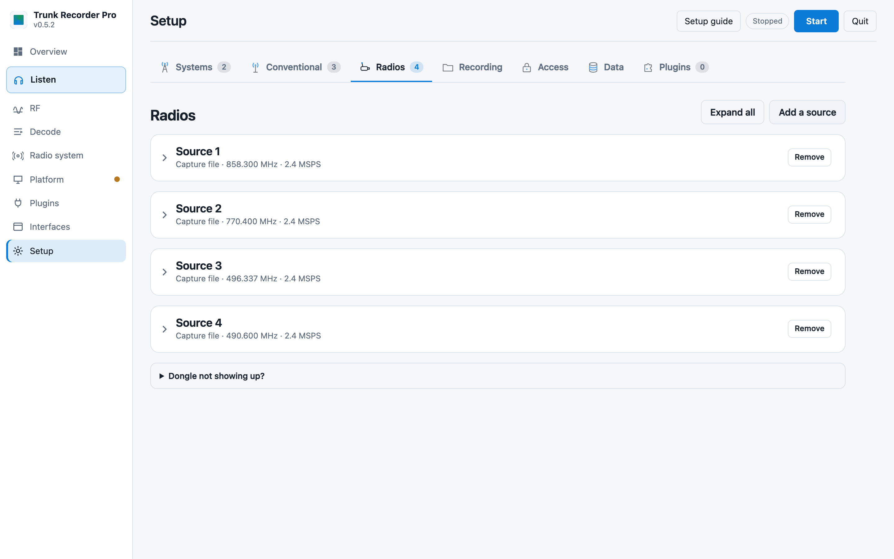

# Radios

This page explains how Trunk Recorder Pro uses your radios (it calls them *sources*): how much
spectrum each covers, where it is tuned, gain, frequency correction, and running several at once.
Installing drivers for USRP, Airspy, HydraSDR, bladeRF and SoapySDR radios is covered in
[Other radios](../install/other-radios.md); every source key is listed in the
[configuration reference](../configuration/sources.md).

All of these settings are on the **Radios** tab of **Setup**, one card per source. **Add a
source** adds another; the buttons at the top of a card pick its kind: **RTL-SDR**, **HackRF**, **USRP**,
**Airspy**, **HydraSDR**, **bladeRF**, **SpyServer**, **SoapySDR** or **Capture file**. Only RTL-SDR (on USB) and
Capture file work in the browser; the other kinds need the desktop app. An RTL-SDR's **Connection** is **USB** or **rtl_tcp**: a dongle
on another machine, found by its **Server address**, as a SpyServer is. Besides its kind, a card has a **Name** (shown in the
**Receive on** labels) and, on an RTL-SDR on USB, a **USB transfer size**.

<picture>
  <source media="(prefers-color-scheme: dark)" srcset="../img/shots/setup-radios-dark.png">
  
</picture>

## What a source is

A source is one radio (or one capture file) delivering a slice of spectrum. Trunk Recorder Pro
doesn't tune a radio to each call. It tunes each radio once, to a center frequency, and the radio
hands over everything within its bandwidth. The recorder then picks out the control channel and
every voice channel from that stream in software, as many at once as there are calls.

So the questions for each radio are: how wide a slice does it deliver (sample rate), and where is
that slice (center frequency)?

## Sample rate and coverage

The sample rate, in millions of samples per second (MSPS), is how wide a slice the radio
delivers: at 2.4 MSPS it covers 2.4 MHz, from 1.2 MHz below the center to 1.2 MHz above.

Not all of that is usable. Every radio filters its band before sampling it, and near the edges
that filter rolls off and signals from outside the band fold back in. Trunk Recorder Pro leaves a
**guard band** unused at each edge (75 kHz by default, see [Guard band](#guard-band-and-roll-off)).
At 2.4 MSPS that leaves 2.25 MHz you can record from.

The sample rates offered for each kind:

| Kind | Offered | Notes |
|---|---|---|
| RTL-SDR | 2.4, 2.048, 2.56, 3.2, 1.92, 1.024 MSPS | 2.4 MSPS is the default; above 2.4 the card says *May drop samples · 2.4 is dependable* |
| HackRF | 1 to 20 MSPS | |
| SpyServer | 2.5, 3, 2.4, 5, 6, 10, 1.25 MSPS, or any rate typed in | one the server offers: its top rate halved, to the nearest whole Hz (an R2's usually starts at 2.5, then 1.25…); another is refused, with the ones it offers (the recorder asks the server at the address, and Setup lists those) |
| USRP | 2.4 to 20 MSPS, or any rate typed in | any rate its master clock divides to; default 8 MSPS |
| Airspy | 10, 6, 3, 2.5 MSPS | R2: 10 or 2.5; Mini: 6 or 3 |
| HydraSDR | 10, 5, 2.5 MSPS | |
| bladeRF | any rate typed in, 0.52 to 61.44 MSPS | over ~40 MSPS needs USB 3 and a fast CPU |
| SoapySDR | 2 to 10 MSPS, or any rate typed in | one the device supports |

Wider costs more CPU, but not by much: see [CPU](#cpu). A system whose frequencies spread wider
than one radio can cover needs a wider radio or several radios.

## Center frequency and Auto

**Center frequency, MHz** is the middle of the radio's slice. Leave it blank and the recorder
places the radio itself (**Auto**); the hint under the field shows where it went
(`Auto: 858.3000 MHz`), or *Auto: nothing left to cover* when there's nothing left
for it to cover.

Each Auto source in turn is placed over what the sources before it don't reach yet: what each
system needs first (a control channel, or a DMR, NXDN or EDACS site's frequencies, or a
conventional system's channels), then as many of the remaining channels as fit. The exact rules are
in [Center frequency and Auto](../configuration/sources.md#center-frequency-and-auto). The center is
kept off every channel, because most SDRs have a spike at their exact center frequency (the DC
offset), and a channel sitting on it decodes badly.

If nothing fits, Start is blocked with *Set a center frequency for source N — it couldn't be
placed automatically*. Then type a center yourself.

Auto is a good choice for a single radio on a single system. With several radios, or when you
want a radio over the busiest voice channels rather than in the middle, set the centers yourself;
Find my system and the setup guide both do this for you.

### The coverage bar

Under each source card is a bar showing its band. The highlighted middle part is the usable range
(the band less the guard band at each edge), with the range in MHz under it. Each system's
channels inside it are drawn as ticks in the system's colour: a tall tick for a control channel,
a short one for a known voice channel (conventional channels in plain text colour). The legend
names the systems with channels inside, or says *nothing in range*. Hover over a tick to see what
it is.

On the **Systems** tab, each system card says which source its control channel is on, and, when
the survey has found voice channels, how many are covered ("Voice 14/16").

## Guard band and roll-off

The **Guard band** is the part of each edge of a radio's band that is left unused, in kHz at each
edge. It defaults to 75 kHz, and can be set from 0 up to a quarter of the sample rate. A channel
inside the guard band isn't recorded from that radio.

Why have one: near the edges of the band the radio's anti-alias filter rolls off, and signals
just outside the band fold back over the edge. A wider guard band is safer; a narrower one covers
more. If you're coming from Trunk Recorder, its usable bandwidth was set by its own filter chain;
here it is this one number per source.

### Profile roll-off

**Profile roll-off…** measures where your radio's edges sag. It opens a panel:

1. Under **Look at**, type a frequency to tune the radio to. A quiet part of the spectrum is best,
   with the antenna connected and the gain as you'll record. (A capture file is looked at where it
   was recorded.)
2. Press **Measure**. The recorder opens the radio by itself for about 1.5 seconds, so recording
   has to be stopped first.
3. It shows a waterfall and the averaged spectrum, with the noise floor in blue and the guard band
   shaded at each edge. It reports how far in from the low and high edge the noise floor is 3 dB
   down, and how far down it is at the very edge.
4. It suggests a guard band: the larger of the two 3 dB points plus half a channel (7.5 kHz),
   rounded up to 5 kHz. Drag on the plot or use the slider to try other values; the channels your
   systems use are drawn as ticks, and any that would fall in the guard band are listed. Press
   **Use ... kHz** to keep it.

When you add a source, its card offers *New radio: measure its roll-off?* You can
**Skip** it.

Treat the suggestion as conservative. The roll-off turns signal and noise down alike, so a gentle
sag at the edges doesn't by itself cost decoding; the real problem is signals folding in from
outside the band, which the noise floor can't show. On an RTL-SDR at 2.4 MSPS the floor sags
slowly, so the suggestion comes out well over the 75 kHz default. If a channel near an edge
decodes fine at the default, there's no need to give it up.

The same measurement from the command line (an RTL-SDR, or a capture file), printed as JSON:

```bash
trunk-pro rolloff --serial 200 --center 858300000 --rate 2400000 --gain 28
trunk-pro rolloff capture.cu8 --center 858300000 --rate 2400000
```

`--full` adds the spectra and waterfall to the output. See [Command line](../command-line.md).

## Gain and AGC

Gain is how much the radio amplifies the signal before sampling it. Too little and weak control
channels don't decode; too much and strong signals (a nearby pager or broadcast transmitter, or
the system's own site) overload the radio, and everything gets worse. More gain also raises the
noise, so past a point it doesn't help.

Most kinds of radio have an **AGC** switch, which lets the radio set its own gain. A fixed gain
usually works better for trunked systems, so the default is AGC off (except on SoapySDR devices).

| Kind | Gain setting | Default |
|---|---|---|
| RTL-SDR | **Gain, dB**, 0 to 49.6 on most dongles, or **AGC** | 25.4 dB, AGC off |
| rtl_tcp | as an RTL-SDR: **Gain, dB** or **AGC** (taken by the far end), and **Bias-T** | 25.4 dB, AGC off |
| SpyServer | **Gain step**, the server's own (R2: 0 to 21), and **Digital gain, dB** (blank: automatic) | step 14, automatic |
| HackRF | **LNA (IF) gain** 0 to 40 dB in steps of 8, **VGA (baseband) gain** 0 to 62 dB in steps of 2, and the **Amp** (+14 dB, overloads near strong signals) | LNA 16, VGA 20, amp off |
| USRP | **Gain, dB** (B200/B210: 0 to 76), or **AGC** (B200 / B210 and E3xx only) | 40 dB, AGC off |
| Airspy | **Gain**: **Linearity** or **Sensitivity**, a step 0 to 21; or **Each stage**: **LNA** 0 to 14, **Mixer** and **VGA (IF)** 0 to 15, with **AGC** for the LNA and mixer | Linearity, step 14 |
| HydraSDR | as an Airspy (below); an **Input** setting picks ANT, CABLE1 or CABLE2, with the Bias-T on the first | Linearity, step 14 |
| bladeRF | **Gain, dB** overall (bladeRF 2.0: about −15 to 60), or **AGC** | 30 dB, AGC off |
| SoapySDR | **Gain, dB** overall (blank leaves it as the device has it), then **Gain stages, dB** one by one (SDRplay IFGR / RFGR...), or **AGC** | AGC on |

On an Airspy, **Linearity** is best near transmitters and **Sensitivity** for weak signals.

A gain changed in Setup while recording applies at once on an RTL-SDR, an Airspy or a HydraSDR
(AGC on or off too, and an Airspy's preset or stages), on a HackRF (its LNA, VGA and amp), and on
a USRP, bladeRF or SoapySDR device for the gain in dB with AGC off (AGC on or off there applies at
the next start), and on a SoapySDR device for its gain stages too, by name, with AGC off (without an
overall gain, removing a stage or the overall gain applies at the next start); the log says the
gain each took.
Anything else about a radio applies when recording starts next: Stop, then Start.

How to set it:

- **Let the survey do it.** On an RTL-SDR, Find my system tries gains from 19.7 to 49.6 dB while
  listening to the control channel and keeps the lowest one within 1 dB of the best signal that
  doesn't clip. See [Find my system](find-my-system.md#gain).
- **Let `trunk-pro tune` do it.** While recording, `trunk-pro tune` tries gains on the radio,
  following a plan for its kind (an Airspy along its linearity table, here or through SoapySDR,
  an RTL-SDR along its tuner's gains, a HackRF's LNA before its VGA and its amp last, another
  SoapySDR radio by its gain elements), and scores each by what that radio's
  systems decode: control channel first, then voice. Nothing is saved while it tries; the radio
  goes back unless you pass `--apply`. See the [command line](../command-line.md#tune).
- **Watch the dashboard.** While recording, a source's line warns *Gain too high · 2.1% clipping*
  when more than 0.5 % of samples are at full scale, or *Gain too high · peaks at full scale*, and
  suggests *Gain may be low · peaks −40 dBFS* when its peaks stay a few steps tall for a minute
  and it carried no call in the last day (only a suggestion: its light stays green, since a source
  on rarely used voice channels can be that quiet at a working gain). Each ends with the way out:
  **Tune gain** where you can run it, else *lower it in Setup* or *raise it in Setup*. The **RF**
  page has a **Tune gain** button for each source, which tries gains while recording and keeps the
  best (unlike `trunk-pro tune`, it applies the result), and shows each radio's headroom and noise
  floor over time.
- **Watch the control channel.** If it decodes most messages, more gain won't help. If it loses
  many, try a few dB more, or less if there are strong signals nearby.

If no gain gives a clean control channel, the trouble is usually elsewhere: an antenna that isn't
made for the band, a poor location, or a noisy USB hub or computer nearby.

## Frequency correction (ppm) and AutoTune

An SDR's tuning is set by a crystal, and cheap crystals are off by a few parts per million (ppm).
The error scales with frequency: 2 ppm is 1.7 kHz at 858 MHz. A narrow digital channel 2 kHz
off decodes badly or not at all, and crystals drift as they warm up.

**Correction, ppm** (in the **Frequency correction** group) tells the recorder how far off the radio is, so it can tune
correctly. On an RTL-SDR it's a whole number (the dongle takes whole ppm); other radios take
decimals.

There are three ways to find the number:

- **Find my system** measures it: the control channel announces its own frequency, and base
  stations are locked to GPS, so the difference between where your radio hears it and where it
  says it is is your radio's error. **Add this system** sets it.
- **While recording, Setup measures it.** Under the ppm field, a source card shows *Measured
  +1.40 ppm* once a control channel on it has been measured, and offers **Set correction
  to N ppm** when the error is 0.3 ppm or more. The error is measured whether AutoTune is on or
  not. The **RF** page shows it too, and the dashboard warns when a source is more than 2 ppm off
  with AutoTune off. (The RF page also shows the *sample clock*, `clockPpm` in a source's status:
  the radio's crystal measured against the computer's clock, which times the calls.)
- **AutoTune** corrects for it automatically (see below).

### AutoTune

**AutoTune** follows crystal drift using the control channel. It works on P25 and SmartNet
control channels. Here is what it does:

- Every 10 seconds, while the control channel is decoding, it measures how far off the control
  channel comes in, as ppm. Each digital call of a second or more adds a measurement too. It keeps
  the median of the last 20 measurements per source (measurements over 50 ppm are thrown away).
  A new run starts from the score the earlier run saved.
- With AutoTune on, every voice channel opened from then on is corrected by that median, on top
  of the ppm you set.
- When the correction has moved more than 150 Hz (at the control channel's frequency) from the
  one a P25 control channel was opened with, the control channel is reopened at the corrected
  frequency, at most once every 200 seconds. SmartNet control channels are measured but not
  reopened.

AutoTune corrects around the ppm you set, so it works best when the ppm is roughly right to start
with: a control channel that is too far off to decode can't be measured. Set the ppm (or let Find
my system set it), then turn on AutoTune to follow drift. While recording, the source card shows
how much AutoTune is correcting by (*Corrected +0.40 ppm*).

Conventional channels take up a source's correction too, between calls. A source with only
conventional channels has no control channel to measure; digital rows you mark can measure it
from their calls instead. See [Conventional channels: frequency correction](conventional.md#frequency-correction).

## Suggested settings

When the calls heard (weighted by how many) show that a source could be set better, Setup →
**Radios** shows a **Suggested settings** banner above the sources. Its figures say what taking the
advice does: **Systems missed**, **Channels reached**, **Radios needed** and **Sample rate**.
**Apply all** takes all of it. Each card shows its own change as **Suggested**, with the center
and sample rate, and a **Use** button, or **Suggested Remove** when the other sources reach
everything it does. The **RF** page shows the same banner with **Review in Setup**.

## Running several radios

More radios cover more spectrum: a second dongle can catch the voice channels the first can't
reach, or another system entirely.

### How channels are shared out

When a call comes in, its voice frequency is recorded from the **first source, in the order on
the Radios tab, whose usable range covers it**. Control channels are the same: each is opened on
the first source that covers it. Where two radios overlap, the one higher in the list gets the
channels in the overlap.

To keep a trunked system on particular radios (a band on one antenna, say), tick them under **Receive on** in
its Setup page, or list their labels in its `receiveOn` (`["RTL-SDR SN 200"]`, as the dashboard names
them). A pin names the radio, so moving it in the list keeps it; taking it out stops Start until the
system's sources are chosen again, rather than letting another radio stand in. Its control and voice
channels are then taken only from those radios, still the first that reaches each, and a channel none of
them reaches isn't recorded. A conventional system is kept to radios channel by channel instead: each
row's **Source** (its `receiveOn`), shared by the rows on one frequency. Left empty, either can use any.
Auto placement follows these: a radio something is kept on is placed for it, and one nothing else may
use isn't placed for what's kept elsewhere. Setup's coverage chips and the dashboard's "not needed"
note go by the same choice.

A call whose frequency no source covers isn't recorded; a system's page under **Radio system** says *out of
range*, and the **Radio system** page counts these as *Out of band* (*No source covers the
frequency*) and lists their frequencies, with the nearest source and how far past its usable edge each is. A system with no control channel inside any source can't start: *no control channel
falls inside a source's bandwidth — move the center frequency*.

### Placing several radios

- **Auto** places each radio over what the radios before it don't cover yet (see
  [Center frequency and Auto](#center-frequency-and-auto)). **Suggested settings** on the Radios
  tab says when a different center or rate would reach more (see
  [Suggested settings](#suggested-settings)).
- **The setup guide's Coverage step** does: the scanning radio covers the control channel, and
  each other radio goes over the busiest voice channels still out of reach, weighted by how many
  calls the scan saw on each.
- **By hand**, type each radio's center so their usable ranges sit side by side, and check the
  coverage bars. The **Decode** page will tell you when a frequency decodes worse because it is at
  the edge of a radio's band (*move the centre toward it*).

### Telling dongles apart

RTL-SDR dongles are told apart by their USB serial number. The **Dongle** list on a source card
shows each connected dongle as its product name and serial (`· SN 200`); one another source
names is greyed out, marked with that source (*(Source 1's)*). **First available** (an empty serial) opens the first
RTL-SDR found. **Refresh** looks again after you plug one in.

With more than one dongle, give each source a specific dongle, not **First available**: which
dongle is "first" can change from one start to the next.

Many dongles leave the factory with the same serial (often `00000001`), or none. Trunk Recorder
Pro can't tell those apart, and it has no way to change a dongle's serial. Use librtlsdr's
`rtl_eeprom` tool to give each one its own serial (for example `rtl_eeprom -d 0 -s 00000200` for
the first dongle), unplug and replug it, then pick it in Setup. With more than one dongle plugged in,
Setup's **Dongle** list greys out each one it can't tell apart, *(no serial)* or *(same serial as
another)*, and says what to run, with a serial none of them has. The first steps of the setup
guide list every radio found; one that can't be told apart from one before it is shown but can't
be picked. While another source is on **First available**, the list says it may take any of
them: give it its own too.

Every kind is checked the same way: an Airspy, HydraSDR, HackRF or bladeRF reporting the serial
of another (clones can) is greyed out as *(same serial as another)*. Their serials are set by
their makers, so **First available** is the way to use one of them. A HydraSDR RFOne isn't counted
with the Airspys: an Airspy source on **First available** never opens an RFOne.

Airspys, HydraSDRs and bladeRFs are picked by serial the same way. USRPs and SoapySDR devices are picked by their device
arguments (`serial=...`, `addr=192.168.10.2`, `driver=sdrplay,serial=...`); **Find** lists what's
connected.

`trunk-pro devices` lists the RTL-SDRs with their serials from a terminal.

## CPU

Trunk Recorder Pro splits each radio's band into channels once, with a shared FFT, so the cost
depends mostly on the sample rate, and very little on how many calls are being recorded. Measured
on live systems (see [Performance](../developer/performance.md)):

| Computer | Radios | CPU, % of one core |
|---|---|---|
| Raspberry Pi 5 | one RTL-SDR at 2.4 MSPS (P25) | 4.2 % idle, 5.0 % with one call, 6.2 % with three |
| Mac mini, Apple M4 Pro | one USRP B200 at 8 MSPS (P25) | 11.7 % average |
| Mac mini, Apple M4 Pro | two RTL-SDRs at 2.4 MSPS each (SmartNet) | 7.6 % average |

Each extra call costs about 0.6 to 0.7 points. If a source drops samples (the dashboard says
*Dropping samples — CPU or USB can't keep up; calls lose audio*), calls on it lose audio; check the
CPU load on the **Platform** page, and try another USB port or fewer dongles per hub.

## Capture files

A **Capture file** source replays a recording of raw IQ instead of a live radio. It's useful for
testing, for reporting a problem, or for trying settings on the same air again and again.

- **Capture file**: the path to the file on the recorder's computer (in the browser version,
  **Choose file...**, forgotten on reload).
- **Sample format**: **cu8** (`rtl_sdr`'s unsigned 8-bit), **cs16** (signed 16-bit) or **cf32**
  (32-bit float, as GNU Radio and UHD write). It's guessed from the file's extension: `.cf32`,
  `.cfile`, `.fc32`, `.complex` are cf32; `.cs16`, `.sc16` are cs16; anything else cu8. The browser
  version reads cu8 only.
- **Center frequency, MHz** and **Sample rate**: what the capture was recorded at. These must be
  right; the file doesn't say.
- **Real-time pace**: on, it plays back at the speed it was recorded; off, as fast as it decodes.

A capture can't be retuned, so Find my system looks at it once, at its center frequency.

To make a capture with an RTL-SDR:

```bash
trunk-pro capture dcfd.cu8 --freq 858300000 --rate 2400000 --gain 28 --serial 200 --seconds 30
```

Captures can also be replayed straight from the command line with `trunk-pro replay`, without
the interface. See [Command line](../command-line.md).
