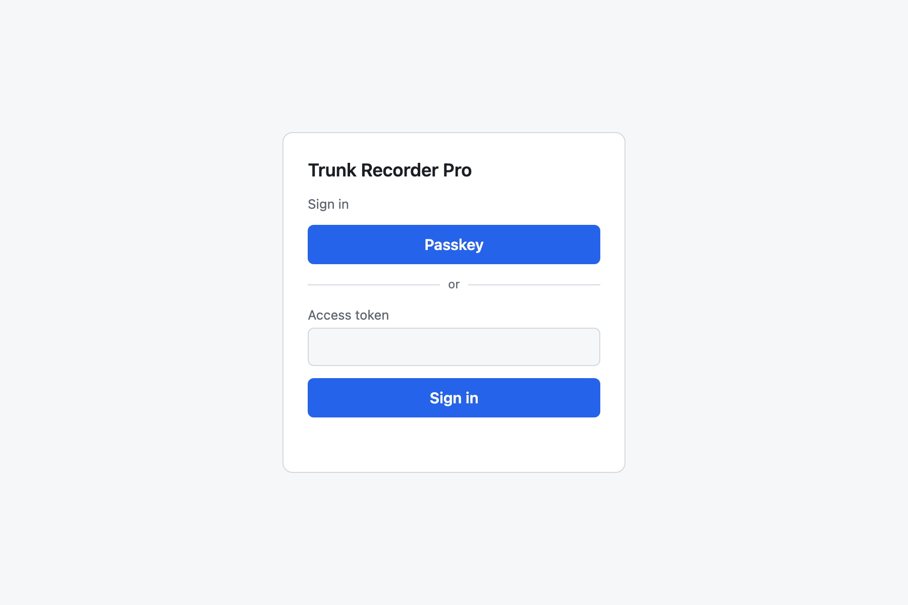
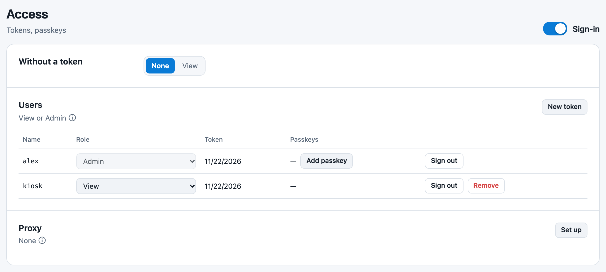

# Remote access and signing in

This page covers reaching the recorder from another computer, turning signing in on (users, View
and Admin, passkeys), HTTPS, and reaching it from anywhere with Tailscale, a proxy or Cloudflare Tunnel. Every key is
listed in [Server, log and monitor](../configuration/server-and-log.md); the wire level (routes,
tokens, 401s) is in the [API docs](../api/README.md#signing-in).

## Reaching it from another computer

By default the interface only answers on this computer (`127.0.0.1`). To reach it from another
machine on your network, choose **Other devices too** under **Direct connections** in Setup →
**Access** and restart the app (it saves `server.bind` as `0.0.0.0`: every address). Or start with
`--bind 0.0.0.0`, or set `server.bind` in the config (see
[Server](../configuration/server-and-log.md#server)); a `--bind` overrides the setting, and
Setup says so:

```bash
trunk-pro serve --bind 0.0.0.0 --no-open
```

**Reachable at**, below it, lists every way to the recorder it found this run, each a link:

| Row | Who | Found from |
|---|---|---|
| **This computer** | A browser on the recorder's computer | Always, unless it listens on one other address |
| **Network** | Devices on that network (its interface, `en0`, `eth0`) | The computer's addresses, while it listens on every address |
| **Tailnet** | Devices on your tailnet, by the computer's MagicDNS name (else its `100.x` address) | Its Tailscale address, while it listens on every address; the name from `tailscale status` |
| **Tailscale Serve** / **Tailscale Funnel** | Your tailnet, over HTTPS / anyone on the internet (**Internet**) | `tailscale serve status`: a handler that proxies to this port |
| **Cloudflare Tunnel** | Anyone on the internet who gets past Cloudflare (**Internet**; **Access** when [Cloudflare Access](#cloudflare-tunnel-and-access) is set up here) | cloudflared's metrics server (`localhost:20241`–`20245`): an ingress rule whose service is this port |
| **Host name** | However `server.hostname` is reached | `server.hostname`, when nothing above is it |

Tailscale Serve, Funnel and Cloudflare Tunnel reach the recorder on localhost, so they work with
**This computer only** too; only the **Network** and **Tailnet** rows need **Other devices too**.
Tailscale and cloudflared are asked once a minute; a cloudflared started with `--metrics`
elsewhere isn't found. In Docker the container's own addresses aren't listed: other devices
use the Docker host's address, at the port it publishes, and the recorder must listen on every
address inside the container for that to reach it.

Then browse to `http://<that machine's address>:8080`. The other interfaces are reachable the
same way, each at its own port (`:8081`, …), which the firewall must let through too. For a
service on Linux, Docker or a Pi, the install pages say where the flag goes
([Linux](../install/linux.md#remote-access), [Docker](../install/docker.md#security)).

**Signing in is off by default.** Until you turn it on, anyone who can reach the built-in
interface's port can change the settings, start and stop recording, quit the app, listen, and
download your recordings. Turn it on with **Sign-in** in Setup → **Access**
([Signing in](#signing-in)): then every browser and program signs in as a user, with their access
token, and gets no more than the user's role allows (View or Admin). An interface with listen
access is safer to share either way: on its port, the recorder can be listened to but not
changed. That's what the other interfaces are for — give the people who listen a player's
address, not the recorder's.

Never open the port to the internet. On plain HTTP a token typed on another computer crosses the
network in the clear. On your own network or a VPN that's fine; otherwise turn on
[HTTPS](#https), or put a reverse proxy that adds it in front. From outside, use a VPN
([Tailscale](#tailscale) is one that needs no port opened), the SSH
tunnel below, or [Cloudflare Tunnel](#cloudflare-tunnel-and-access), with signing in on.

A safer way, from a machine that can SSH to the recorder, is an SSH tunnel. Nothing on the
recorder changes and nothing is exposed to the network. Leave the recorder bound to `127.0.0.1`,
then on your machine:

```bash
ssh -L 8080:localhost:8080 you@recorder.local
```

Leave that running and open <http://localhost:8080>. The interface is now reachable only through
your SSH login.

### Why a page gets "Refused"

The app checks every request a browser sends, so that some other web page you happen to have open
can't drive the recorder behind your back:

- A web page from another origin (a page served somewhere else, a page opened from a file, or an
  interface's page reaching for another port than its own) is refused with
  `Refused a page from <origin>: add it to server.allowedOrigins in the config to let it use the interface.`
- While bound to `127.0.0.1`, a request that arrives under any name other than `localhost` (or a
  loopback address) is refused with `Refused a request for <host>: this server only answers to
  localhost …`. This blocks DNS rebinding. The name in `server.hostname`, and the host of any
  `server.allowedOrigins` entry, are answered too.

To allow a page, add its origin to **Pages served elsewhere** on the Interfaces page
(`server.allowedOrigins`), one per line, as the browser sends it
(`http://192.168.1.50:3000`). `null` allows pages opened from a file, and `*` allows any page:
only on a private network. Programs that aren't browsers (scripts, `curl`) aren't affected by any
of this. With signing in on, a page on an allowed origin also needs an access token: being listed
only lets it in the door.

## Signing in

<picture>
  <source media="(prefers-color-scheme: dark)" srcset="../img/shots/signin-dark.png">
  
</picture>

Signing in is off unless you turn it on. Off, whoever reaches a port gets what that port gives:
control on the built-in interface's, each interface's own `access` on its. On, they also sign in as
a **user**, with that user's **access token** or one of their [passkeys](#passkeys), and get the
lower of the port's access and the user's role.

**Turning it on.** In the app: Setup → **Access**. Turn the **Sign-in** switch on.
With no Admin yet, it asks for one first: give it a name, **Create**, and copy the token's secret
while it's shown (once). The browser is signed in with it, and only then is signing in turned on,
so you can't lock yourself out. (With an Admin already there, it asks for their token's secret
instead, or offers **New Admin token**.) Other browsers get the sign-in page: paste the secret. One sign-in covers the
dashboard and every interface's port on that host name, for 30 days or until **Sign out**.

### Users and roles

<picture>
  <source media="(prefers-color-scheme: dark)" srcset="../img/shots/setup-access-dark.png">
  
</picture>

Each user has a name (who or what signs in) and a role. **New token** in Setup adds one, with
their token. Setup calls the roles View and Admin; the config, the command line and the API call
them `listen` and `control`, the same two an interface's access takes:

| Role (in Setup) | In the config | May |
|---|---|---|
| View | `listen` | See and play everything (status, calls on the air, recorded calls, live audio, the dashboard), change nothing. The config it's sent is only what its pages show: [what View is sent](../configuration/server-and-log.md#what-view-is-sent) |
| Admin | `control` | Everything the built-in interface can, including adding and removing users |

The token's secret (`trp_` and 64 hex digits) is shown once, when it's made. The config keeps only
its SHA-256, so a lost secret can't be recovered: remove the user and add them again. Removing a
user signs out everyone signed in as them (from Setup at once; with `trunk-pro access remove`, at
the restart). Programs and scripts sign in with a token too; see
[Signing in](../api/README.md#signing-in) in the API docs.

**Without a token.** **None** (the default): everything but the sign-in page needs a token.
**View** (`anonymous: "listen"`): anyone who reaches the port can look and listen, and needs a
token only to change things; the dashboard's top bar then has **Sign in**, which goes to the
sign-in page (`/signin`).

### From the command line

On a recorder with no browser nearby, use the command line, then restart the recorder:

```sh
trunk-pro access add luke                    # control by default; prints the token's secret once
trunk-pro access add kiosk --access listen
trunk-pro access on
trunk-pro access list                        # on or off, anonymous, the proxy, and each user
trunk-pro access remove kiosk                # signs out whoever signed in as kiosk
trunk-pro access signout luke                # every browser signed in as luke signs in again
trunk-pro access passkey remove luke iPhone  # one of luke's passkeys, by its name
```

Changes made with `trunk-pro access` are written to the config file and take effect when the
recorder restarts; changes in Setup apply at once. See [Command line](../command-line.md#access).

### Sessions and signing out everywhere

The browser keeps a session, not the token: who signed in, with which token (or passkey), and until when,
signed with a key the recorder keeps in `session-key` beside the config (made the first time,
readable by its owner alone, never in the config). Removing the user, making their token again
or removing the passkey ends their sessions; deleting `session-key` (then restarting the recorder) signs every browser
out. If the recorder can't keep the file it says so in the log, and browsers are signed out
whenever it restarts. What changes as people sign in and out is kept beside the config too, in
`access-state.json`, not in it (signing in never changes the config): when each user was last
signed out everywhere, and each passkey's count of sign-ins. A dashboard left open is closed when its session expires, and asks to sign in again.

**Signing out everywhere.** A browser that may have been left signed in somewhere (a lost phone, a
shared computer): click your name in the top bar → **Sign out everywhere**, or, as an Admin, a
user's **Sign out** in Setup → **Access** (or `trunk-pro access signout <name>`). Every browser
signed in as them until then signs in again, this one too, and their open dashboards close. It
ends sessions, not credentials: a program that sends the access token with each request
(`Authorization: Bearer`, `?token=`) keeps working, and so does anyone who has the token or a
passkey. For a token that may have been seen, make it again (remove the user and add them, or
remove the token); for a device that's gone, remove its passkey (every user's are listed in
**Access**, by name and the day each was added).

### Apps

An app on your computer (Trunk Monitor, for the Mac) signs in by way of the browser: it opens the
recorder's page, you sign in there as you always do (your token, a passkey) and click **Allow**,
and the app is signed in as you, with your role. It never sees your token. It holds a session like
a browser's: 30 days, then it asks again; **Sign out everywhere** ends it too, and so does making
your token again or removing the passkey you signed in with. The log names each app as it's signed
in (`User luke: app "Trunk Monitor on Luke's Mac" signed in (with a passkey "Laptop")`).

Only the dashboard's own page allows an app (never an interface's), and the page says which app,
which user and what access before you click. An app you didn't just open asking to be allowed:
**Cancel**.

Away from the recorder's network, the app needs an address that goes with it: the recorder's
[Tailscale](#tailscale) address or name, with Tailscale connected on the device, or a
[Cloudflare Tunnel](#cloudflare-tunnel-and-access)'s name. Either works at home too.

Behind a [proxy that signs people in](#behind-a-proxy-that-signs-people-in) the proxy's word
covers the app as it does a browser, when the app's requests come through it as you (`tailscale
serve` on your own device). Behind [Cloudflare Access](#cloudflare-tunnel-and-access) they don't:
Access signs people in on a web page. Give the app a user's access token, and a service token to
get through Access: create one in Zero Trust → **Access controls** → **Service credentials**, add
a policy with the action **Service Auth** that includes it to the application, and give the app
its client ID and secret (`CF-Access-Client-Id`, `CF-Access-Client-Secret`). A service token signs
nobody in by itself.

### In the log

Each sign-in that starts a browser's session, with how (`User luke: signed in with
passkey "iPhone"`, `… with their access token`); each passkey added, with how the one adding it was
signed in (`User luke: passkey "iPad" added (signed in with their access token)`), so one added
from a session someone else got hold of shows there and by its date in **Access**; each passkey
removed in Setup, and by whom; and signing out everywhere. Each change a signed-in user makes from the dashboard is logged by its kind (`User luke: setConfig`), also for people a proxy signed in (`User luke (by the proxy): …`), never what it carried. Programs that send a token with each
request, and people the [proxy](#behind-a-proxy-that-signs-people-in) signs in, aren't logged at
each request. Refused sign-ins are logged at `debug` only (anyone may try, again and again). The
lines name users and passkeys, never a secret, and not the address a sign-in came from: View users
can watch the log, and plugins that take it get every line.

### Passkeys

A passkey signs a browser in with the device itself (Touch ID, Face ID, Windows Hello, a phone, a
password manager, a security key): nothing to paste. It's optional; tokens keep working, for
scripts and as the way back in.

**Where they work.** Browsers allow passkeys only on `localhost`, or over [HTTPS](#https) on a
host name, never an IP address. So on the recorder's own computer at `http://localhost:8080` they
just work. From other devices, set `server.hostname` to the name the certificate is for
(`tailscale cert`'s, say) and open `https://radiobox.tail1234.ts.net:8443`. Anywhere else (an IP
address, plain HTTP on the name) the sign-in page and Setup don't offer them. A passkey belongs to
the name it was made on: one made at `localhost` isn't offered at the host name, and the other way
round.

**One address: the dashboard's.** The recorder takes a passkey's answer only from the built-in
interface's own page, at an address it works out itself, never from what a request says:

| Signed in at | Passkeys work at |
|---|---|
| `localhost` | `http://localhost:<port>` (`https://` with [HTTPS](#https) on), the built-in interface's port as the recorder listens on it |
| `server.hostname` | `https://<hostname>`: the port written in `hostname` if it has one (`"radio.example.com:8443"`); else the built-in interface's port when the recorder serves HTTPS itself; else 443 (a proxy or tunnel in front serves the HTTPS) |

- **Not on an interface's port.** Interfaces are other people's pages, and a sign-in counts on every
  port of the name, so an interface's page could otherwise have your passkey sign its own server in
  with your role. On an interface's port the sign-in page offers **Passkey ↗** instead, which opens
  the dashboard's sign-in page; signed in there, the interface's port is signed in too (the cookie
  covers the name, whatever the port).
- **Reached at another port** (an SSH tunnel's `localhost:9000`, Docker publishing `8080` as
  `9080`, a proxy at a port `hostname` doesn't name): signing in with a passkey is refused with
  "Passkeys work at … alone", the address they do work at; tokens work as ever. Use that address,
  map the same port, or write the proxy's port in `hostname`.
- **`localhost` is a computer's own.** A passkey made at `http://localhost:8080` signs in whatever
  answers at `localhost:8080` on that computer: an SSH tunnel's or Docker's port mapped to that
  number is, to the browser, the same place.

**Adding one.** Signed in (with your token, the first time), open Setup → **Recording** →
**Access**: your row has **Add passkey**, with a name for it (the browser and system, unless you
change it). The browser asks to make it; it's saved at once. Each user adds their own, on their own
device: an Admin can't add one for someone else, but can remove anyone's. With a passkey, you may
remove your token (the **×** by its date), as long as you can still sign in.

**Signing in.** The sign-in page has **Passkey** above the token field; browsers that fill in
passkeys also offer them from the field itself. No name to type: the passkey says whose it is.
The device must check it's you (a fingerprint, a face, a PIN, its password), adding and signing
in: a security key that's only touched is refused.
A sign-in waits with the browser while you answer (signed by the recorder, good for 5 minutes,
and good once), so opening the sign-in page again and again keeps nothing on the recorder and
can't push anyone else's out.

The config keeps each passkey's public key, never anything secret. A passkey kept on one device
(a security key) counts its uses, and the count is saved when it goes up (never down), so a copy
is refused; if the count can't be saved (the config can't be written), the sign-in is refused
too. Passkeys synced between devices don't count, so signing in with them writes nothing.

### Locked out?

On the recorder's computer, `trunk-pro access off`, then restart the recorder.
Open Setup, add a new Admin, and turn **Sign-in** back on. (`--config file.json` for a config
somewhere else.) Other sign-in problems are in
[Troubleshooting](../troubleshooting.md#signed-out-or-locked-out).

## Tailscale

[Tailscale](https://tailscale.com/) puts the recorder's computer and your own devices on one
private network (a tailnet) wherever they are, with no port opened and nothing on the internet.
Install it on the recorder's computer and on each device, signed in to the same account. The
recorder then has a second address (`100.x.y.z`, and with MagicDNS a name, `radiobox`) that
answers from any of them, at home and away. Either of these puts the recorder on it:

- **Listen on every address.** Choose **Other devices too** in Setup → **Access** (or start with
  `--bind 0.0.0.0`); **Reachable at** then lists a **Tailnet** row, `http://radiobox:8080`.
  Tailscale encrypts what crosses it, so plain HTTP is fine there; the port answers on your own
  network too.
- **Tailscale Serve.** Leave `bind` at `127.0.0.1`, so nothing but Tailscale reaches the port, and
  have Tailscale serve it over HTTPS with a certificate of its own:

  ```bash
  tailscale serve --bg 8080
  ```

  ```json
  "server": { "bind": "127.0.0.1", "port": 8080, "hostname": "radiobox.tail1234.ts.net" }
  ```

  Then open `https://radiobox.tail1234.ts.net` (the **Tailscale Serve** row). Without `hostname` the recorder refuses the
  requests ("this server only answers to localhost"). [Passkeys](#passkeys) work at that name, and
  Serve says who's asking, so the recorder can
  [take its word](#behind-a-proxy-that-signs-people-in) and nobody signs in twice.

Everyone on the tailnet who can reach the computer reaches the port: turn [signing in](#signing-in)
on unless the tailnet is yours alone. On a phone, turn on Tailscale's **VPN On Demand** so the
recorder is there without opening Tailscale first.

## HTTPS

On plain HTTP the secret crosses the network in the clear, as everything else does.
That's fine on your own network, over a VPN or an SSH tunnel. Otherwise turn on HTTPS
(`server.tls`, its keys in [HTTPS](../configuration/server-and-log.md#https)), or put a reverse
proxy that adds it in front. Setup → **Access** says **Unencrypted** when the page
was opened over plain HTTP from another computer: the token you paste and the sign-in cookie cross
the network readable, to anyone who can watch it.

```json
"server": { "bind": "0.0.0.0", "port": 8443, "tls": { "cert": "radiobox.crt", "key": "radiobox.key" } }
```

The certificate must name the address you open it at (a phone at `https://radiobox.tail1234.ts.net:8443`
needs a certificate for `radiobox.tail1234.ts.net`). Set `server.hostname` to that name, and
the log and the browser the app opens use it; without it they use `https://localhost:…` (or the
`bind` address), which a certificate for another name won't match.

**Getting a certificate.** The recorder doesn't make one; any of these do:

- **Tailscale**: `tailscale cert radiobox.tail1234.ts.net` writes `radiobox.tail1234.ts.net.crt`
  and `.key` (HTTPS certificates turned on in the Tailscale admin console). Run it again before
  it expires (90 days); the recorder picks up the new files.
- **Let's Encrypt**, for a name in DNS you control: [certbot](https://certbot.eff.org/) or
  [acme.sh](https://github.com/acmesh-official/acme.sh), with a DNS challenge if the recorder isn't
  reachable from the internet. Point `cert` at `fullchain.pem` and `key` at `privkey.pem`, and
  make sure the user the recorder runs as can read them.
- **mkcert**, on a home network: [mkcert](https://github.com/FiloSottile/mkcert) `radiobox.local 192.168.1.20 localhost`,
  and install its root (`mkcert -install`) on each device that opens the recorder.

A self-signed certificate works too, but every browser warns about it, and [passkeys](#passkeys)
(and other features browsers keep to secure pages) won't work with it.

**No certificate at all:** behind [Cloudflare Tunnel](#cloudflare-tunnel-and-access) (or another
proxy that serves HTTPS), the recorder stays on plain HTTP and the proxy serves the certificate.

In Docker, mount the certificate's folder into the container: see
[Docker](../install/docker.md#https).

## Behind a proxy that signs people in

If a reverse proxy in front of the recorder already signs people in (Authelia, Authentik,
oauth2-proxy, `tailscale serve`, Caddy's `forward_auth`), the recorder can take its word for who
they are, so nobody signs in twice. The proxy passes the name in a header; the recorder believes
that header only from the proxy's own addresses. Cloudflare Access is different: the recorder
checks the token it signs, so it needs no addresses (see [Cloudflare Tunnel and
Access](#cloudflare-tunnel-and-access)). Off unless set; it does nothing while signing in is off.
Its keys (`from`, `header`, `cloudflare`, `users`, `other`) are in
[Proxy](../configuration/server-and-log.md#proxy).

```json
"auth": {
  "enabled": true,
  "users": {
    "luke": { "access": "control" },
    "kiosk": { "access": "listen", "token": { "hash": "…", "created": 1763000000 } }
  },
  "proxy": {
    "from": ["127.0.0.1", "::1"],
    "header": "Remote-User",
    "users": { "luke@example.com": "luke" },
    "other": "listen"
  }
}
```

- **Who they are.** The name is the user `users` maps it to, else the user of that name, with
  that user's role. They need no token or passkey. Any other name gets `other`.
- **A token or session says who first.** A request with a valid token (`Authorization: Bearer`,
  `?token=`) or a browser already signed in here (the cookie) is that user; the header counts only
  when none of those does.
- **It counts where the cookie would**: from the recorder's own pages, an address typed in or a link
  followed, and programs. Not from another site's page (even one `allowedOrigins` lets in), since
  the browser sends its sign-in at the proxy along with that page's requests too.
- **Changes apply at once.** Removing the user, changing their mapping or role, or removing the
  proxy or its address closes their connections, as for any user.
- **Signing out** is the proxy's: the dashboard shows no **Sign out** for someone the proxy signed in.
- **A way back in.** With a proxy set, an Admin with no token counts as a way in (the proxy can
  name them). If the proxy goes wrong, `trunk-pro access off` on the recorder's computer works as ever.
- In the app: Setup → **Access** → **Proxy** sets `from`, `header` (or, for
  **Cloudflare**, **Team** and **Audience**) and **Others** (`other`); `users` is edited in the config file.

**Which header.** `Remote-User` is Authelia's. The others name it differently, so set `header` to match:

| Proxy | `header` | Notes |
|---|---|---|
| Authelia | `Remote-User` (also `Remote-Email`, `Remote-Name`, `Remote-Groups`) | Its forward-auth (nginx `auth_request`, Traefik `forwardAuth`, Caddy `forward_auth`) must pass them on, as Caddy's does with `copy_headers` |
| Authentik | `X-authentik-username` (or `X-authentik-email`) | Its proxy outpost's forward-auth. Caddy's `forward_auth` needs them in `copy_headers`, capitalised: `X-Authentik-Username` |
| oauth2-proxy | `X-Forwarded-Email` (or `X-Forwarded-User`, `X-Forwarded-Preferred-Username`) | `--pass-user-headers` (on by default) in reverse-proxy mode; with nginx `auth_request`, `--set-xauthrequest` gives `X-Auth-Request-Email` (or `-User`) and the proxy must copy it over with `proxy_set_header` |
| Cloudflare Access | none: set `cloudflare` | The recorder checks Access's signed token (`Cf-Access-Jwt-Assertion`) and ignores its plain email header. See [Cloudflare Tunnel and Access](#cloudflare-tunnel-and-access) |
| `tailscale serve` | `Tailscale-User-Login` | `luke@github` or an email. Serve strips its own headers from what clients send. Only tailnet requests carry them: none from Funnel, none from tagged devices. `from`: `127.0.0.1` and `::1` |

**The proxy must strip the header from what clients send.** Anything that reaches the recorder from
an address in `from` is believed, so a path through the proxy that passes a client's own
`Remote-User` along lets anyone be anyone. Authelia, Authentik and oauth2-proxy expect the proxy in
front to replace the header, and `tailscale serve` and Caddy's `forward_auth` `copy_headers` do;
on any path that doesn't (and in a plain Nginx or Caddy proxy), take it out:

```nginx
proxy_set_header Remote-User "";      # nginx: an empty value isn't sent
```

```caddy
reverse_proxy 127.0.0.1:8080 {
    header_up -Remote-User            # Caddy
}
```

With `from` set to `127.0.0.1`, every program on that computer can send the header too. With the
proxy on the same computer, keep `bind` at `127.0.0.1`, so nothing else reaches the port at all, and
set `hostname` to the name the proxy serves (bound to localhost, the recorder answers to it).

Caddy with Authelia, for example:

```caddy
radio.example.com {
    forward_auth authelia:9091 {
        uri /api/authz/forward-auth
        copy_headers Remote-User
    }
    reverse_proxy 127.0.0.1:8080
}
```

## Cloudflare Tunnel and Access

[Cloudflare Tunnel](https://developers.cloudflare.com/cloudflare-one/networks/connectors/cloudflare-tunnel/)
puts the recorder at a name of yours (`https://radio.example.com`) with no port opened: `cloudflared`,
on the recorder's computer or beside it in Docker, connects out to Cloudflare, and Cloudflare
passes requests for that name back down it to `http://localhost:8080`. Cloudflare serves the
HTTPS, so the recorder needs no `server.tls`. WebSockets (the dashboard's live updates and audio)
work through it as they are.

**1. The tunnel.** Either way, the name ends up pointing at the recorder's plain-HTTP port.

- *From the dashboard* (a remotely-managed tunnel): in Zero Trust, create a tunnel, run the
  `cloudflared` command it shows with its token, then add a published application (public
  hostname): your name, service URL `http://localhost:8080`.
- *From the command line* (a locally-managed tunnel):

  ```bash
  cloudflared tunnel login
  cloudflared tunnel create radio
  cloudflared tunnel route dns radio radio.example.com
  cloudflared tunnel run radio
  ```

  with `~/.cloudflared/config.yml`:

  ```yaml
  tunnel: <the tunnel's UUID>
  credentials-file: /home/you/.cloudflared/<the tunnel's UUID>.json
  ingress:
    - hostname: radio.example.com
      service: http://localhost:8080
    - service: http_status:404      # the catch-all rule a config file must end with
  ```

  `cloudflared service install` keeps it running as a service (on Linux, with `sudo`, give it the
  config: `sudo cloudflared --config /home/you/.cloudflared/config.yml service install`).

**2. The recorder.** Set `hostname` to the tunnel's name, and keep `bind` at `127.0.0.1` so only
programs on this computer (cloudflared among them) reach the port:

```json
"server": { "bind": "127.0.0.1", "port": 8080, "hostname": "radio.example.com" }
```

- Without `hostname`, a recorder bound to localhost refuses the tunnel's requests ("this server only
  answers to localhost"): they're for `radio.example.com`, which it doesn't know as its own.
- Cloudflare tells the recorder the browser came over HTTPS (`X-Forwarded-Proto: https`), so the
  sign-in cookie is `Secure`. [Passkeys](#passkeys) work at `https://radio.example.com` (the
  recorder serves no HTTPS itself, so the proxy in front does, at 443).
- Turn [signing in](#signing-in) on: through a tunnel, the recorder is on the internet. Tokens and
  passkeys work through the tunnel with nothing else set up.

**In Docker**, run `cloudflared` as a second service beside the recorder, and point the tunnel at
the recorder's service name instead of localhost (service URL `http://trunk-pro:8080`, the name in
[docker-compose.yml](../install/docker.md)). Drop the recorder's `ports:` then, or keep it to
`"127.0.0.1:8080:8080"`; only the tunnel needs to reach it:

```yaml
  cloudflared:
    image: cloudflare/cloudflared:latest
    restart: unless-stopped
    command: tunnel --no-autoupdate run --token ${TUNNEL_TOKEN}   # the dashboard tunnel's token, in .env
```

In the container the recorder listens on every address (`--bind 0.0.0.0`), so it answers to any
name; set `hostname` all the same, for passkeys and the URLs it logs.

**3. Access (optional): Cloudflare signs people in.** With an
[Access application](https://developers.cloudflare.com/cloudflare-one/access-controls/applications/http-apps/self-hosted-public-app/)
in front, people sign in at Cloudflare (with the identity providers you give it) before a
request reaches the tunnel, and the recorder can take Cloudflare's word for who they are:

1. In Zero Trust → **Access controls** → **Applications**, add a **Self-hosted** application for
   `radio.example.com`, with a policy for who may in (an application lets nobody in until one does).
2. Open it again and copy its **Application Audience (AUD) Tag**.
3. Set `proxy.cloudflare` to your team name (the `myteam` of `myteam.cloudflareaccess.com`) and
   that tag, and map the emails Access signs people in with to the recorder's users:

```json
"auth": {
  "enabled": true,
  "users": { "luke": { "access": "control" }, "kiosk": { "access": "listen", "token": { "hash": "…", "created": 1763000000 } } },
  "proxy": {
    "cloudflare": { "team": "myteam", "aud": "4714c1358e65fe4b408ad6d432a5f878f08194bdb4752441fd56faefa9b2b6f2" },
    "users": { "luke@example.com": "luke" },
    "other": "listen"
  }
}
```

Or in the app: Setup → **Access** → **Proxy** → **Set up** → **Cloudflare**.

- **The token, not the header.** Access sends each request with the email it signed in
  (`Cf-Access-Authenticated-User-Email`) and a token it signed (`Cf-Access-Jwt-Assertion`).
  Anything that reaches the port can send the email header, cloudflared's neighbours on
  `127.0.0.1` included, so the recorder ignores it and, as
  [Cloudflare advises](https://developers.cloudflare.com/cloudflare-one/access-controls/applications/http-apps/authorization-cookie/validating-json/),
  checks the token: signed (RS256) by one of your team's keys, issued by your team, for this
  application's Audience tag, and not expired. Then the email in it is the name, mapped through
  `users` and `other` as any proxy's is. No `from` is needed: the signature is the proof.
- **The team's keys** are fetched from `https://myteam.cloudflareaccess.com/cdn-cgi/access/certs`
  when first needed, kept, and fetched again hourly and for a token signed by a key not kept
  (Cloudflare rotates them), at most once a minute. The recorder must reach that address. If it
  can't, Access signs nobody in (the log says so once); tokens and passkeys still work.
- A token, a session or a passkey's sign-in says who first, as for any proxy; another site's page
  gets nobody. Signing out is Cloudflare's (its session lasts as long as the application says). A
  dashboard open with Access's token is closed when that token expires (a minute's leeway), and
  reconnects with the one the browser has then.
- A service token's requests carry no email, so they sign nobody in; give a program an access
  token of the recorder's instead.
- A token refused (another application's, expired, a clock far off) is logged once a reason, so an
  Audience tag pasted wrong shows in the log.
