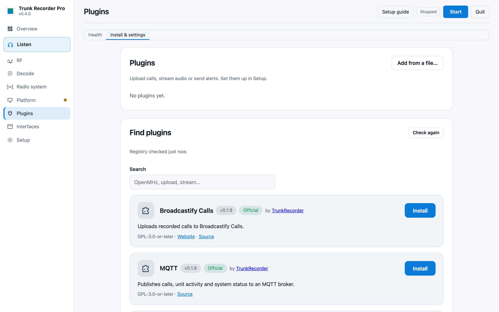
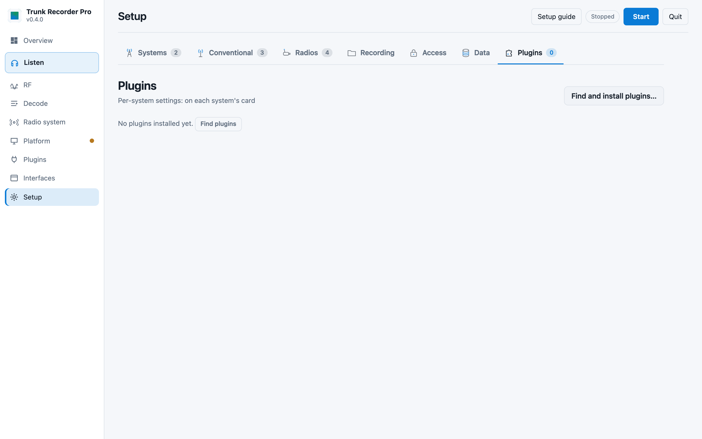

# Plugins

This page covers what plugins are, how to install, set up, update and remove them, and how to see
how they're doing. Each published plugin has a page of its own (listed [below](#the-published-plugins)).

Plugins are how Trunk Recorder Pro sends calls somewhere else: uploading to OpenMHz, Broadcastify
Calls or an Rdio Scanner server, streaming live audio to another program, or running a script of
your own on each call. None of that is built into the recorder. If you're coming from Trunk
Recorder, the OpenMHz and Broadcastify uploaders and `uploadScript` that were built into it are
plugins here.

Plugins run in the desktop app and the server (`trunk-pro serve`, including the
[Docker image](../install/docker.md)). The [browser version](../install/browser.md) has no plugins.

## How plugins work

A plugin is a separate program. The recorder starts it when recording starts, tells it what
happens, and stops it when recording stops. Some things that follow from that:

- **They talk in JSON lines.** The recorder writes one JSON message per line to the plugin's
  stdin, and the plugin answers the same way on its stdout. Anything the plugin prints to stderr
  goes to its log. So a plugin can be written in any language.
- **They only watch.** A plugin hears the events it subscribed to: calls starting and ending,
  recorded calls landing on disk, radios registering and affiliating, live audio, system status.
  It can answer with log lines, a health status, and what became of each call (uploaded,
  skipped, failed). Nothing a plugin says changes what gets recorded.
- **A plugin that crashes is restarted.** If its process exits, the recorder starts it again
  after a second, then waits twice as long after each further crash, up to a minute (back to a
  second once it has run for a minute). Events wait for it meanwhile. The one exception is a
  plugin that stops because its settings are wrong: it says what's wrong, and isn't restarted
  until you change its settings or start recording again.
- **A slow plugin falls behind; the recorder doesn't.** Each plugin has a queue of 1024 messages.
  When a plugin can't keep up and its queue is full, it misses events, and the log says
  `is falling behind: N event(s) dropped so far`. The recorder never waits for a plugin.
- **They get time to finish.** When recording stops, each plugin is told to stop and given 10
  seconds to finish (after it has read what was still queued for it). The upload plugins use that
  time to send what they can and save the rest, which they send when recording starts again. A
  plugin that hasn't exited by then is killed (`didn't stop in time: killed`).

Plugins only run while recording. With recording stopped, a plugin that's on shows
**Runs while recording**.

## Where plugins live

Installed plugins are in `plugins/<id>/` beside the config file, and each plugin's own data (its
saved upload queue, its working folder) in `plugin-data/<id>/`, kept across restarts, updates and
uninstalls. See [Files kept beside the config](../configuration/README.md#files-kept-beside-the-config).

## Installing a plugin

### From the Plugins page

<picture>
  <source media="(prefers-color-scheme: dark)" srcset="../img/shots/plugins-install-dark.png">
  
</picture>

1. Open **Plugins** in the sidebar and choose the **Install & settings** tab.
2. Under **Find plugins** you'll see the plugins in the registry, each marked **Official**
   (from the recorder's authors) or **Community** (someone else's, reviewed).
3. Press **Install** on the one you want. It downloads, checks and installs; the button shows
   *Downloading…*, *Checking it…*, *Installing…* as it goes.
4. A new plugin is installed **off**. The app takes you to its card in **Setup**, on the
   **Plugins** tab, to fill in its settings and turn it on.

The list comes from the plugin registry, [github.com/TrunkRecorder/plugins](https://github.com/TrunkRecorder/plugins).
Each entry there pins one release of a plugin by its SHA-256 checksum. The recorder downloads the
archive for your computer, checks it against that checksum and refuses it if it differs, unpacks
it, runs the plugin to ask who it is, and only then replaces what was installed. If the registry
can't be reached, the page says **Registry unreachable** and shows the list fetched last, or the
copy built into the app. **Check again** fetches it again.

Plugins are built for Linux (x86-64 and 64-bit ARM, including a Raspberry Pi with a 64-bit OS),
macOS and Windows (x86-64). On anything else a plugin shows **Not built for this computer**.

### From a GitHub release

A plugin that isn't in the registry can be installed from its GitHub release: press
**Install from GitHub…** and give the repository (`https://github.com/someone/trunk-plugin-pager`)
or a release page, and optionally a release tag (the latest otherwise). The release has to have
been made with the [plugin template's](writing-plugins.md#releasing) release workflow. Its files
are checked against the release's own `SHA256SUMS`, which proves they arrived intact, not that
anyone looked at them: such plugins are marked **Not reviewed**.

Only install plugins you trust. A plugin is a program running with your user's permissions on
this computer.

### From the command line

The same store from a terminal:

```bash
trunk-pro plugin search                 # every plugin in the registry
trunk-pro plugin search upload          # those whose name or description has "upload"
trunk-pro plugin install openmhz        # install from the registry
trunk-pro plugin install https://github.com/someone/trunk-plugin-pager --tag v1.2.0
trunk-pro plugin update                 # update every installed plugin
trunk-pro plugin update openmhz         # or just this one
trunk-pro plugin uninstall openmhz
trunk-pro plugin list                   # what's installed, on or off, and the M4A encoder
```

Add `--config path/to/config.json` if your config isn't in the usual place: plugins are installed
beside it. A plugin installed this way is off; turn it on in Setup. See the
[command-line reference](../command-line.md) for every option.

## Setting a plugin up

<picture>
  <source media="(prefers-color-scheme: dark)" srcset="../img/shots/setup-plugins-dark.png">
  
</picture>

Plugins are set up in **Setup**, like the rest of the recorder, and their settings are saved in
`config.json` as you type.

- **Settings for the whole recorder** are on Setup's **Plugins** tab. Each installed plugin has a
  card there with an **On/Off** switch and its settings. The **Set up** button on a plugin's card
  on the Plugins page takes you there.
- **Settings for each system** (an upload key, say) are on that system's card, under **Plugins**,
  once the plugin is on. Conventional systems get them too, once they have a channel. The plugin's
  card in Setup shows a chip for each system, marked ✓ when it's set up for that system and ! when
  it isn't; click one to go to it.

The forms are drawn from what each plugin says about its settings: text boxes, switches, menus,
lists of numbers, and groups you can add and remove (simplestream's streams, for example). A
field left empty uses the plugin's default, shown greyed in the box. Fields the plugin needs are
marked **Needed**, and the plugin shows **Needs setting up** until they're filled in. A plugin that
needs a recorder-wide setting isn't started until it's set: the log says
`[<plugin>] not started: <setting> isn't set`, and the Health tab shows a warning. A setting needed
per system doesn't stop the plugin; it just skips the systems that lack it. Secret
fields (API keys) are hidden; **Show** reveals them.

Most per-system settings work as an on switch for that system: OpenMHz, for example, uploads only
the systems you've given an API key, and skips the rest.

### Per system and per site

A plugin is on for every system and site until you turn it off for some.

- **Systems.** On the plugin's card in Setup, a chip for each system: turn one off and nothing
  about that system is sent to the plugin. A plugin that takes `totals` (every system's figures)
  stays on for all of them.
- **Sites.** On a multi-site system's card, a **Sites** row of chips under the plugin: turn a site
  off and its radio activity and status aren't sent, nor a recorded call only it heard.
- **Shared settings.** A plugin that lets a system set again some of its recorder-wide settings
  (an uploader's server, say) has **<plugin> shared settings** on the system's card. Empty means
  the recorder-wide setting. A setting the plugin doesn't let a system set shows under
  **Ignored overrides** on the plugin's card, with **Remove**.
- **Per-site settings.** A plugin that lets a site set some of a system's settings again (a site
  that is a system of its own on the service) has a row for each site on the system's card.
- **A second copy.** **+ Add plugin** on a system's card runs the plugin again for that system,
  with settings of its own.

In the config file these are `systemsOff` and `sitesOff` on the plugin's entry, and `override`,
`perSite` and a list in place of one object in a system's entry: see
[the plugins configuration reference](../configuration/plugins.md).

### Changes apply at once

While recording, changing a plugin's settings, turning a plugin on or off, or changing the M4A
settings restarts the plugins with the new settings (**Changes restart it.**, says the card). The
old processes get 10 seconds to finish and save their queues, and the new ones start as soon as
they've exited, so no calls are lost in between.

### In the config file

A plugin's entry under `plugins` holds whether it's on and its recorder-wide settings; each
system's `plugins` holds its settings for that system. The keys and an example are in the
[plugins configuration reference](../configuration/plugins.md); the keys inside `settings` are
each plugin's own, on its page.

Plugins know systems by their **short name**. If you rename a system, settings that choose a
system from a menu (like a simplestream stream's **System**) follow the new name.

## M4A audio

OpenMHz and Broadcastify Calls upload compressed audio (M4A), not WAV. The recorder encodes each
call once, however many plugins asked, with an encoder already on the computer (ffmpeg, afconvert or
fdkaac). Without one, OpenMHz and Broadcastify won't start, and say why; others send WAV instead
(Rdio Scanner). Encoders, settings and what's kept are in [M4A files](../guides/recordings.md#m4a-files).

## What happens to the files

Every plugin that takes recorded calls answers on each one: done, skipped or failed. **Done and
skipped count the same**: the plugin is finished with the call. Once all of them have answered (or
an hour has passed), the **Archive** settings on Setup's **Recording** tab decide what stays. See
[The archive](../guides/recordings.md#the-archive-whats-kept-and-whats-deleted).

## Decrypted calls

A call decrypted with [keys you hold](../configuration/systems.md#encryption-keys-keys) is what the system's
owner chose to encrypt, so **no plugin is given one** (its live audio, its WAV or M4A, its JSON) unless you
turn on **Share decrypted calls** on that plugin's card in Setup → Plugins (`"shareDecrypted": true` in its
entry). The switch is there only when a system has keys.

- A call sent to a public service (OpenMHz, Broadcastify) can be heard by anyone and can't be taken back,
  and may be against the law or your agreement with the system's owner. A server of your own may be
  reachable from outside, or pass calls on.
- A plugin that isn't allowed says so in the log, once a run, the first time a decrypted call passes it by.
  One that is allowed says so each time it starts.
- Only the audio and files are held back: the call's other details (talkgroup, units, `algid`, `key_id`) go
  as before. A call no plugin may take is kept as when no plugin is set up.

## Seeing how plugins are doing

### The Plugins page

On **Plugins** > **Install & settings**, each installed plugin's card shows:

- its state: **Running**, **Needs attention** (it's working but something's wrong, like calls
  waiting to retry), **Not running**, **Starting…**, **Off**, **Can't run** (the recorder
  couldn't run it, with why), or **Needs setting up**
- its latest status message, from the plugin
- what it has done this recording: so many done, skipped and failed, and the last failure
- what it listens to (**Hears recorded calls**, **live audio**, …) and **Uploads M4A audio** if it
  asks for M4A
- **Log (N)**: its last 50 log lines
- **Update to vX** when the registry has a newer version, else **Reinstall**: the same again from
  where it came (the registry, its GitHub repository's latest release, or your build's file). A
  running plugin restarts with it, and its settings carry over
- **Uninstall** (a build of your own: its settings are forgotten, the file stays)

A plugin's log lines (except debug ones) also go to the recorder's log, prefixed with its id, like
`[openmhz] uploading dcfd as dcfd (key …3f)`.

### The Health tab

**Plugins** > **Health** is the plugins' dashboard. Each plugin that's on gets a card with:

- **Sent**, **Failed**, **Waiting** (calls queued, and how many are waiting to retry) and
  **Upload time**
- a bar per minute for the last hour: sent, skipped and failed
- the services it talks to, each **up**, **degraded** or **down**, with the last success and
  error. A service counts as down after 3 failures in a row, or 5 minutes without a success
  while calls are waiting
- any figures of its own the plugin reports, such as simplestream's **Packets sent** and
  **Packets dropped**
- when it last succeeded and failed, how long it has been up, how many **Restarts** it had, and how many events it **Fell behind** on
- **Last 24 h and log**: charts of sent, failed and waiting, and its log

A change in a plugin's health (to a warning, to an error, or back to working) shows up as an
event in the dashboard's event feed. See [Events](../guides/interface.md#events).

## Removing a plugin

Press **Uninstall** on its card on the Plugins page (or `trunk-pro plugin uninstall <id>`). That
deletes `plugins/<id>/` and forgets its settings, for the whole recorder and for every system.
Its data folder, `plugin-data/<id>/`, is kept. To stop a plugin without losing its settings, turn
it **Off** in Setup instead.

## Coming from Trunk Recorder

**Setup → Systems → Import…** brings over the settings of Trunk Recorder's uploaders and plugins
that have a counterpart here (OpenMHz, Broadcastify Calls, Rdio Scanner, simplestream,
`uploadScript`), installed or not. Each plugin's page says which settings map to what; the
[migration guide](../migrating-from-trunk-recorder.md#uploads-and-streaming) has the whole table.

## Running a build of your own

To run a plugin you've built, or any executable that speaks the protocol:

- On the Plugins page, press **Add from a file…** and give the executable's path. The recorder
  asks it who it is, and adds it, off, marked **your build**.
- Or in `config.json`, give its entry a `path`:

  ```json
  "plugins": { "pager": { "enabled": true, "path": "/home/me/trunk-plugin-pager/target/release/pager" } }
  ```

`path` runs that executable instead of an installed copy. The store doesn't update it, and
**Uninstall** forgets it without deleting the file. After you rebuild, **Reinstall** runs the new
build (restarting it while recording).

## Trying a plugin on recorded calls

`trunk-pro plugin run` starts a plugin the way the recorder does, sends it calls already on disk,
prints everything it says back, and stops it. You don't need a radio attached.

```bash
# The 5 newest calls under the recordings folder, through your own build
trunk-pro plugin run ./target/release/pager ~/TrunkRecorderPro --limit 5

# An installed plugin by id, with its settings from your config
trunk-pro plugin run openmhz ~/TrunkRecorderPro/dcfd --limit 3

# Settings from a file instead: {"config": {…}, "systems": {"<shortName>": {…}}}
trunk-pro plugin run ./target/release/openmhz ~/TrunkRecorderPro --settings settings.json
```

```
Data folder: /tmp/trunk-pro-plugin-run-openmhz
M4A: ffmpeg
[openmhz] info: uploading dcfd as dcfd (key …3f)
[openmhz] status ok: running
[openmhz] ✓ dcfd/2026/10/3/1039-1791035412_858587500 https://openmhz.com/system/dcfd
```

✓ is a call done, – one skipped, ✗ one failed (with why).

Each call is a `.json` file, or a folder (the newest `--limit` calls in it, 10 by default). A run
by id uses your real settings, so an upload plugin really uploads. The plugin gets a scratch data
folder in the system's temp folder rather than its real one, so a test run doesn't leave calls
queued for the installed plugin. Other options (`--capture-dir`, `--encoder`, `--grace`,
`--data-dir`) are in the [command-line reference](../command-line.md).

`trunk-pro plugin describe <executable>` prints a plugin's manifest: its id, version, what it
subscribes to, and its settings.

## The published plugins

| Plugin | What it does |
|---|---|
| [OpenMHz](openmhz.md) | Uploads recorded calls to OpenMHz |
| [Broadcastify Calls](broadcastify.md) | Uploads recorded calls to Broadcastify Calls |
| [Rdio Scanner](rdioscanner.md) | Uploads recorded calls to an Rdio Scanner server |
| [simplestream](simplestream.md) | Streams live call audio to other programs over UDP or TCP |
| [Upload script](upload-script.md) | Runs a script of yours on each recorded call |
| [MQTT](mqtt.md) | Publishes calls, radio activity and system status to an MQTT broker |
| [Notifications](https://github.com/TrunkRecorder/trunk-plugin-notify) (`notify`) | Rules over what the recorder hears (signals, tones, emergencies, new talkgroups and radios), sent to webhooks (Discord, Slack, ntfy, JSON) and commands |

To write your own, see [Writing plugins](writing-plugins.md).
